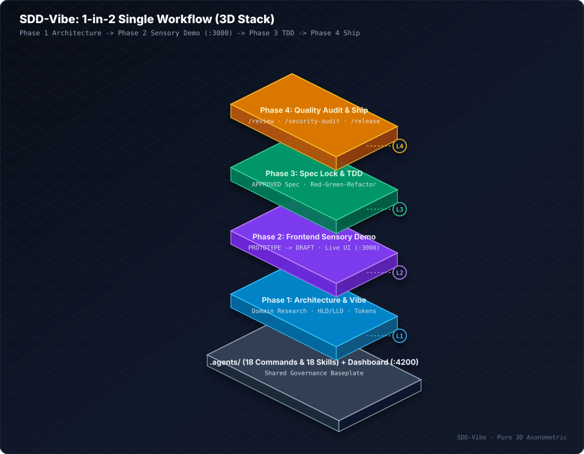

# Contributing to SDD-Vibe

<!-- SDD-VIBE-3D-DIAGRAM -->


Thank you for your interest in contributing to SDD-Vibe! This guide covers the contribution process.

## Getting Started

1. **Fork** this repository and clone your fork.
2. Copy `SDD-Vibe-Framework/` to a test workspace.
3. Run `python scripts/init_project.py --ides all` to verify the framework bootstraps correctly.
4. Run the test suite: `node scripts/run-tests.js` (from within `SDD-Vibe-Framework/`).
5. Run the doc checks: `python scripts/check_docs.py`.

## Development Workflow

This project follows its own SDD-Vibe methodology:

1. **Plan first** — open an issue describing the change before submitting a PR.
2. **Write tests first** — add or update tests in `tests/` for any behavioral change.
3. **Pass all checks** — ensure `check_docs.py`, `manifest.py --check`, and all `test_*.js` files pass.
4. **One feature per PR** — keep pull requests focused on a single change.

## What to Contribute

### High-Value Contributions
- **Reference implementations** — build a small app using the framework end-to-end.
- **New agent skills** — add specialized skills in `.agents/skills/` following the existing pattern.
- **Dashboard improvements** — enhance the Project-Manager-Dashboard with new telemetry modules.
- **IDE adapter support** — extend `sync_ide_adapters.py` for additional IDEs.
- **Test coverage** — add behavioral tests for parser methods or doc-check logic.

### Documentation
- Fix typos, broken links, or unclear instructions.
- Add new playbooks in `playbooks/`.
- Improve quick-start guides.

## Code Standards

- **Python**: stdlib only (no pip dependencies in framework scripts), type hints encouraged.
- **JavaScript**: Node.js stdlib only for dashboard (zero external dependencies), `const`/`let` over `var`.
- **Markdown**: follow the governed document pattern (see `docs/INDEX.md`).
- **Agent skills**: must include valid YAML frontmatter with `name` and `description`.

## Commit Messages

Follow conventional commit format:
```text
type(scope): description

feat(dashboard): add memory usage gauge to overview
fix(parser): handle empty task.md gracefully
docs(guide): clarify Phase 2 exit criteria
test(parser): add behavioral tests for parseErrors
```

## CI Checks

Every PR must pass:
- `python scripts/check_docs.py` — documentation conformance
- `python scripts/manifest.py --check` — manifest integrity
- `node --check` on all dashboard JS files — syntax validation
- All `test_*.js` suites — framework tests
- Secret scan — no credentials in code

## Reporting Issues

Use GitHub Issues with the provided templates. Include:
- Steps to reproduce
- Expected vs actual behavior
- IDE and OS version
- Relevant error output

## Code of Conduct

Be respectful, constructive, and inclusive. We follow the [Contributor Covenant](https://www.contributor-covenant.org/).