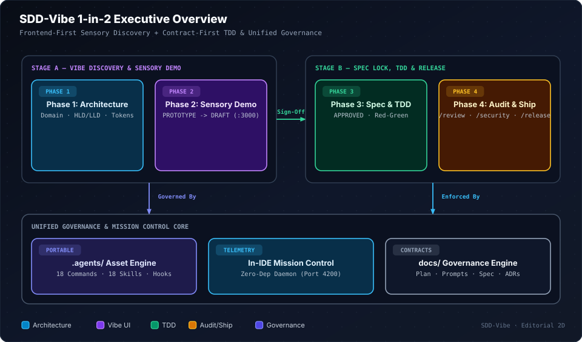
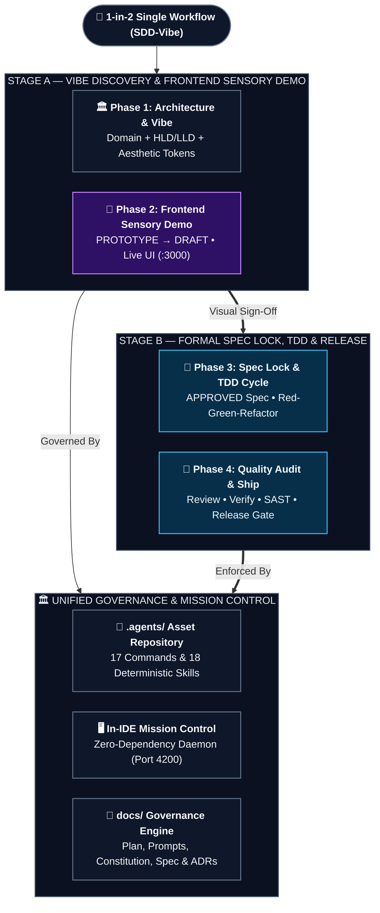
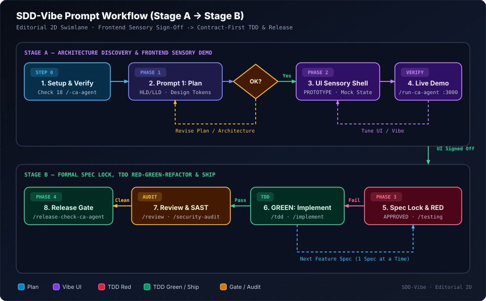
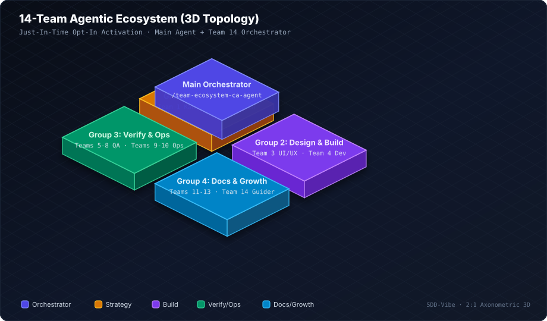
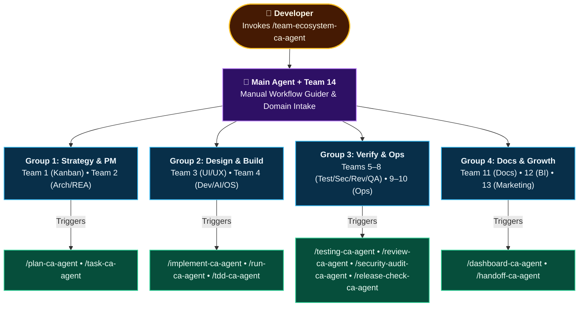

# AI-Powered Project Development Framework
### 🧭 1-in-2 Single Workflow Framework: Unified Vibe-Coding + Spec-Driven Development (SDD + TDD)

<!-- SDD-VIBE-3D-DIAGRAM -->


<div align="center">

[](.)
[](.)
[](LICENSE.md)
[](.github/SECURITY.md)
[](.)

**Engineering Lead:** Chandan Adhikary · **Standard:** Production-Grade Universal Release  
**Supported Platforms:** Claude Code · Cursor · Windsurf · Antigravity · OpenCode · Codex · Trae · VS Code

[🌟 Executive Overview](#-executive-overview) • [🧭 1-in-2 Single Workflow](#-the-1-in-2-single-workflow-framework) • [🔄 Hybrid Pipeline](#-prompt-workflow-diagram) • [🤖 Agentic Skill Workflow](#-agentic-team-ecosystem-skill-workflow-first-choice) • [📁 Blueprint](#-repository-architecture-blueprint) • [⚡ Quick-Start](#-quick-start-guide-step-by-step-for-any-project) • [🖥️ Dashboard](#-in-ide-project-manager-dashboard) • [📖 Catalog](#-complete-documentation-catalog)

</div>

---

## 🌟 Executive Overview

This repository provides a single, unified, battle-tested engineering framework—**SDD-Vibe (1-in-2 Single Workflow)**—for developing **production-grade software** using autonomous AI coding agents. Instead of forcing a choice between rapid visual prototyping and formal enterprise rigor, **SDD-Vibe** combines **Vibe-Coding's** frontend-first sensory demo and fluid iteration with **SDD + TDD's** contract-first specifications, Red-Green-Refactor discipline, and measurable quality gates in one seamless pipeline.



<details>
<summary>Mermaid overview source (text fallback)</summary>



</details>

### The 4 Foundational Directives of Agentic Engineering:
> 1. **Never Code Speculatively:** Autonomous agents must first inspect repository governance, synthesize domain architecture, configure living documentation, and obtain explicit human sign-off before writing production code.
> 2. **Pre-Prompting Domain Knowledge & System Design Synthesis:** Before Step 5 (First Prompting), establish deep domain mastery and system design blueprints (HLD/LLD); if not manually prepared, instruct the AI agent to formulate the architecture during planning.
> 3. **Mandatory Development Logging (`logs/` Folder):** Always maintain clean, sanitized development logs (`logs/dev.log`, `logs/test.log`, `logs/server.log`, `logs/error.log`) inside a dedicated `logs/` directory.
> 4. **Staged Web Development (Frontend-First Verification):** For web applications, never build all features at once. First develop the frontend (UI design, layout, responsiveness, mock/client state), verify it via a live demo run (`/run-ca-agent`), and only after visual sign-off proceed to formal spec lock, TDD backend persistence, security, and release gates.

---

## 🧭 The 1-in-2 Single Workflow Framework

One unified starter blueprint (`SDD-Vibe-Framework/`) that scales smoothly from rapid UI discovery to enterprise-grade production assurance:

| Workflow Phase | Focus & Philosophy | Key Artifacts & Commands | Exit Gate |
| :--- | :--- | :--- | :--- |
| **Phase 1: Architecture & Vibe Discovery** | Domain mastery, HLD/LLD, aesthetic tokens | `docs/product.md`, `docs/design.md`, `docs/plan.md`, `docs/prompts.md`, `/plan-ca-agent` | Human Architecture & Vibe Sign-Off |
| **Phase 2: Frontend-First Sensory Demo** | Rapid UI shell, mock state, conversational tuning | `docs/features/` (`PROTOTYPE` → `DRAFT`), `/run-ca-agent` (`:3000`) | Visual & Interactive Demo Approved |
| **Phase 3: Formal Spec Lock & TDD** | Contract-first backend, DB, auth, Red-Green-Refactor | `docs/spec.md`, `docs/approvals/`, `/spec-check-ca-agent`, `/testing-ca-agent`, `/tdd-ca-agent`, `/implement-ca-agent` | 100% Green Tests (`AC-*` → `TEST-*`) |
| **Phase 4: Quality Audit & Ship** | Pre-commit review, SAST security, release checklist | `/review-ca-agent`, `/verify-ca-agent`, `/security-audit-ca-agent`, `/release-check-ca-agent` | Zero-Defect Production Release |

---

## 🔄 Prompt Workflow Diagram

```mermaid
%%{init: {'flowchart': {'curve': 'basis', 'padding': 16, 'nodeSpacing': 28, 'rankSpacing': 44}}}%%
flowchart TB
    classDef step fill:#082f49,stroke:#38bdf8,stroke-width:1.5px,color:#f0f9ff;
    classDef vibe fill:#2e1065,stroke:#c084fc,stroke-width:1.5px,color:#faf5ff;
    classDef gate fill:#451a03,stroke:#fbbf24,stroke-width:2px,color:#fffbeb;
    classDef red fill:#4c0519,stroke:#fb7185,stroke-width:2px,color:#fff1f2;
    classDef green fill:#064e3b,stroke:#34d399,stroke-width:2px,color:#ecfdf5;
    classDef ship fill:#022c22,stroke:#10b981,stroke-width:2px,color:#d1fae5;

    subgraph Row1 ["STAGE A — DISCOVERY & FRONTEND SENSORY PROTOTYPING"]
        direction LR
        subgraph P1 ["🏛️ PHASE 1: ARCHITECTURE & VIBE DISCOVERY"]
            Setup(["`**⚙️ Setup**
Copy SDD-Vibe-Framework/`"]):::step
            CmdCheck["`**🔍 Verify Commands**
Check 17 /-ca-agent Contracts`"]:::gate
            Prompt1["`**💡 Prompt 1: Architecture**
Plan Mode • HLD/LLD • Tokens`"]:::step
            HumanP1{"Design Approved?"}:::gate
        end

        subgraph P2 ["🎨 PHASE 2: FRONTEND SENSORY DEMO"]
            Prompt2["`**🏗️ Prompt 2: UI Shell**
PROTOTYPE Spec • Mock State`"]:::vibe
            LiveDemo["`**🌐 Live Demo (/run-ca-agent)**
Inspect at :3000 • Tune Vibe`"]:::vibe
            VibeGate{"UI Approved?"}:::gate
        end
    end

    subgraph Row2 ["STAGE B — FORMAL SPEC LOCK, TDD & PRODUCTION SHIP"]
        direction LR
        subgraph P3 ["🧪 PHASE 3: SPEC LOCK & TDD CYCLE"]
            LockSpec["`**📋 Prompt 3: Spec Lock**
IN REVIEW → APPROVED`"]:::step
            RedPhase["`**🔴 RED: Failing Tests**
/testing-ca-agent`"]:::red
            GreenPhase["`**🟢 GREEN: Backend & Auth**
/tdd-ca-agent • /implement`"]:::green
            NextFeature{"More Features?"}:::gate
        end

        subgraph P4 ["🚀 PHASE 4: QUALITY AUDIT & SHIP"]
            Audits["`**🛡️ Pre-Flight Audits**
/review • /verify • /security-audit`"]:::step
            Release(["`**🎉 Production Ship**
/release-check-ca-agent`"]):::ship
        end
    end

    Setup -->|"Workspace Ready"| CmdCheck
    CmdCheck -->|"Verified"| Prompt1
    Prompt1 -->|"Submit Plan"| HumanP1
    HumanP1 -->|"Revise"| Prompt1
    HumanP1 -->|"Approved"| Prompt2

    Prompt2 -->|"Launch Server"| LiveDemo
    LiveDemo -->|"Tune UI"| VibeGate
    VibeGate -->|"Iterate"| Prompt2
    VibeGate ==>|"UI Signed Off"| LockSpec

    LockSpec -->|"Contract"| RedPhase
    RedPhase -->|"Minimal Code"| GreenPhase
    GreenPhase -->|"All Green"| NextFeature
    NextFeature -.->|"Yes: Next Spec"| Prompt2
    NextFeature -->|"All Done"| Audits
    Audits -->|"Gates Passed"| Release

    style Row1 fill:#0b1120,stroke:#334155,stroke-width:1.5px,color:#e2e8f0
    style Row2 fill:#0b1120,stroke:#334155,stroke-width:1.5px,color:#e2e8f0
    style P1 fill:#0f172a,stroke:#1e293b,stroke-width:1px,color:#cbd5e1
    style P2 fill:#1e1b4b,stroke:#312e81,stroke-width:1px,color:#e0e7ff
    style P3 fill:#0f172a,stroke:#1e293b,stroke-width:1px,color:#cbd5e1
    style P4 fill:#064e3b,stroke:#065f46,stroke-width:1px,color:#d1fae5
```



<details>
<summary>Mermaid workflow source (text fallback)</summary>



</details>

---

## 🤖 Agentic Team Ecosystem Skill Workflow (First Choice)

> **First-Choice Development Model:** Whole features are developed through the bundled [`agentic-team-ecosystem`](SDD-Vibe-Framework/.agents/skills/agentic-team-ecosystem/SKILL.md) skill (`/team-ecosystem-ca-agent`). **SDD-Vibe's 18 `-ca-agent` slash commands, spec locks, and Red-Green-Refactor TDD gates trigger automatically at each step**, while **Team 14 (Manual Workflow Guider)** tells you the exact next command and gate at every turn.



<details>
<summary>Mermaid ecosystem source (text fallback)</summary>



</details>

### 1. Step-by-Step Development Flow (Steps 0–9) & SDD-Vibe Triggers

| Step | Active Teams | What Happens in Development | SDD-Vibe Commands Triggered |
|---|---|---|---|
| **Step 0: Intake** | Main Agent + Team 14 | Classifies domain (`SaaS`, `E-commerce`, `Brand`, `Software`, `App`, `ML/DL/DS`, `CV`, `OS`) and activates only needed teams | `/team-ecosystem-ca-agent` |
| **Step 1: Discovery** | Team 2 + Team 12 (+13 if Brand) | Requirements grilling, ROI/risk analysis, domain vocabulary | `/plan-ca-agent` (Read-Only) |
| **Step 2: Architecture** | Team 2 | HLD/LLD, DB schema, DFD/UML, `docs/plan.md`, `docs/system-architecture.md` | `/plan-ca-agent` → `/task-ca-agent` |
| **Step 3: Sensory Demo** | Team 3 + Team 4 | Frontend-first UI shell (`PROTOTYPE` → `DRAFT`) with mock state | `/implement-ca-agent` (UI) → `/run-ca-agent` (`:3000`) |
| **Step 4: Kanban Sync** | Team 1 | Initializes Kanban + exports Google Sheet CSV after UI sign-off | `/dashboard-ca-agent` (`#ecosystem` + `/api/kanban-export`) |
| **Step 5: Spec Lock & TDD** | Team 4 | Promotes spec to `APPROVED`, writes failing tests (`RED`), implements backend/auth (`GREEN`) | `/spec-check-ca-agent` → `/testing-ca-agent` → `/tdd-ca-agent` |
| **Step 6: Audit & QA** | Teams 5, 6, 7, 8 | Unit/E2E/API testing, SAST/secret scan, code review, QA scorecard | `/review-ca-agent` → `/verify-ca-agent` → `/security-audit-ca-agent` → `/release-check-ca-agent` |
| **Step 7: Docs & Brand** | Team 11 + Team 13 | PRDs, pitch decks, brand guidelines, SEO/AEO/GEO | `/handoff-ca-agent` |
| **Step 8: Deploy Ops** | Team 9 | Docker, Nginx, Redis, cloud/VPS deploy, scaling & rate limits | `/release-check-ca-agent` |
| **Step 9: 24×7 Ops** | Team 10 + Teams 12, 13 | Monitoring, error triage, vulnerability escalation back to Team 4 | `/errorlogs-ca-agent` • `/gitlogs-ca-agent` |

### 2. External Skill Mapping & Exact Trigger Timing

External skills are **optional (Developer Choice)** and **never loaded randomly**. Follow the registry in [`07-curated-external-skills-registry.md`](SDD-Vibe-Framework/.agents/skills/agentic-team-ecosystem/references/07-curated-external-skills-registry.md): activate **at most 1–3 external skills per step**, pick **Rank #1 only** per category, and pass the **5-Point Security Vetting Checklist** before installing.

| Trigger Timing | Task / Bottleneck | Rank #1 External Skill | Frequency Tier | Owning Team |
|---|---|---|---|---|
| **Always-On Core** | Cross-IDE skill baseline & persistent memory | `anthropics/skills` · `claude-mem` | Every-Project Core | Team 2, Team 4, Team 14 |
| **Always-On Core** | Semantic symbol-level code navigation & editing | `serena` | Every-Project Core | Team 2, Team 4 |
| **Step 1 (Discovery)** | Relentless requirement & design-decision grilling | `grill-me` | Phase-Gate (Step 1) | Team 2, Team 14 |
| **Step 2 (Architecture)** | On-demand verified skill discovery | `find-skill` | Phase-Gate (Step 2) | Team 2 |
| **Step 3 (UI Demo)** | React/Next.js performance & UI/UX craft | `vercel-labs` / `modern-web-guidance` (Fallback: `ui-ux-pro-max`) | Every-Project Core | Team 3 |
| **Step 3 (Domain UI)** | Charts, spring animations, 3D hero (only if needed) | `recharts` · `motion-dev` · `react-spline` | Domain-Intuition | Team 3 |
| **Step 5 (AI/LLM Build)** | LLM agent pipelines or reverse-engineering legacy APIs | `dify` / `openhands` · `REA` | Domain-Intuition | Team 2, Team 4 |
| **Step 5–6 (E2E & Pre-Commit)** | Deterministic E2E tests & secret-leak prevention | `playwright` · `gitleaks` | Every-Project Core | Team 5, Team 6, Team 8 |
| **Step 6 (Security Gate)** | SAST (OWASP Top 10), CVE scan & git secret history | `semgrep` · `trivy` · `trufflehog` | Phase-Gate (Step 6) | Team 6 |
| **Step 7 (Docs & Growth)** | Pitch decks, technical SEO/AEO/GEO, social scheduling | `ppt-master` · `claude-seo` · `postiz-app` | Phase-Gate / Domain | Team 11, Team 13 |

### 3. Adding New Custom Features Later or Mid-Development

When adding any new custom feature during an active project or after launch, **Agentic Skill remains First Choice**:
1. **Check Spec Impact:** If modifying an already-`APPROVED` feature, run `/change-request-ca-agent` (`CR-###`) first.
2. **Re-Enter via Agentic Skill:** Run `/team-ecosystem-ca-agent <domain-or-feature>` to classify the new feature and let **Team 14** guide the scope.
3. **Run the SDD-Vibe Loop for That Feature:** `/plan-ca-agent` → `/task-ca-agent` → new spec in `docs/features/NNN-name.md` (`PROTOTYPE`) → `/implement-ca-agent` + `/run-ca-agent` (sensory UI) → `/dashboard-ca-agent` (Kanban sync) → `/spec-check-ca-agent` (`APPROVED`) → `/testing-ca-agent` (`RED`) → `/tdd-ca-agent` (`GREEN/REFACTOR`) → `/review-ca-agent` → `/verify-ca-agent` → `/security-audit-ca-agent`.

### 4. Preset Multi-IDE Chat Tabs (Claude Code, Antigravity, Cursor, Windsurf, Codex, Copilot)

Run `python scripts/sync_ide_adapters.py --ides all` (inside `SDD-Vibe-Framework/`) to preset all `17` `/-ca-agent` commands, `18` skills, and lifecycle hooks into every host IDE:
- **Claude Code:** `.claude/commands/`, `.claude/skills/`, `.claude/settings.json`
- **Antigravity:** `.agents/workflows/` + `.agents/hooks.json`
- **Cursor / Windsurf / Codex / Copilot:** `.cursor/`, `.windsurf/`, `.codex/`, `.github/prompts/`
- **Multi-Tab Pattern:** Keep separate chat tabs per Group or Step (e.g., Tab 1: `/team-ecosystem-ca-agent` + `/plan-ca-agent`, Tab 2: `/run-ca-agent`, Tab 3: `/tdd-ca-agent`, Tab 4: `/dashboard-ca-agent`) so each context window stays focused and token-efficient.

---

## 📁 Repository Architecture Blueprint

```text
SDD-Vibe/
├── README.md                                         # 1-in-2 Single Workflow overview & quick-start
├── LICENSE.md                                        # MIT License (Chandan Adhikary)
├── PROJECT-MANAGER-DASHBOARD-GUIDE.md                # In-IDE Project-Manager-Dashboard Guide (Port 4200)
├── GEMINI.md                                         # Master Agent Configuration & Operational Contracts
├── .github/
│   ├── SECURITY.md                                   # Vulnerability disclosure & security policy
│   └── workflows/frameworks-ci.yml                   # CI pipeline validating SDD-Vibe-Framework
│
├── 🧭 UNIFIED 1-IN-2 GUIDES (STANDALONE):
│   ├── SDD-Vibe-Production-Guide-Universal.md        # Universal 1-in-2 Production Guide for ANY Project
│   ├── SDD-Vibe-Production-Guide-SMS.md              # Reference 1-in-2 Production Guide (EduSphere SMS Demo)
│   ├── SDD-Vibe-Custom-Slash-Command-Universal.md    # Universal 17-Command Reference (1-in-2 Pipeline)
│   └── SDD-Vibe-Custom-Slash-Command-SMS.md          # Reference 1-in-2 Slash Commands Guide (SMS Demo)
│
└── 📦 CANONICAL STARTER BLUEPRINT:
    └── SDD-Vibe-Framework/                           # Unified 1-in-2 Starter Template (Port 4200)
```

---

## ⚡ Quick-Start Guide (Step-by-Step for Any Project)

### Option A: 1-Click GitHub Template
Click **Use this template → Create a new repository** on GitHub *(enabled via Repo Settings → Template repository)*, then rename or open `SDD-Vibe-Framework/` in your IDE.

### Option B: Copy & Rename the Unified Blueprint
1. Copy `SDD-Vibe-Framework/` to your clean workspace.
2. Rename the directory to your target application name in lowercase `kebab-case` (e.g. `my-awesome-saas/`).
3. Open the directory at the root in your AI coding IDE (Cursor, Windsurf, Claude Code, Antigravity, VS Code).

### Step 2: Collision-Free Activation (`activate ca agents`) & Slash Commands
After renaming `SDD-Vibe-Framework/` to your project folder:
1. **In AI Chat (Zero-Friction):** Type **`activate ca agents`** (or `/activate-ca-agent`) — runs `python scripts/init_project.py --ides all`, verifies `logs/`, `check_docs.py`, and `manifest.py --check`. *(Avoids bare `activate`, `start`, or `run` which conflict with Python `venv`, PowerShell `Start-Process`, and IDE built-ins.)*
2. **In Terminal (Wrapper or `.py`):** Run `.\activate-ca-agents.bat` (Windows), `./activate-ca-agents` (macOS/Linux), or `python scripts/init_project.py --ides all`.
3. **Chat Dropdown:** Focus your AI assistant chat box and type `/`. Verify all `18` `*-ca-agent` commands appear with descriptions.

### Step 3: Launch Local Mission Control
Start the zero-dependency telemetry dashboard:
- **Slash Command:** Type `/dashboard-ca-agent` in chat.
- **Direct Terminal:** Run `Project-Manager-Dashboard/open-in-ide.bat` (Windows) or `bash Project-Manager-Dashboard/open-in-ide.sh` (macOS/Linux).
- **IDE Docking:** Open `Simple Browser: Show` and navigate to `http://127.0.0.1:4200`. Dock the tab to Editor Group 2.

---

## 🛡️ The 17 Collision-Free Custom Slash Commands (`.agents/commands/`)

All custom commands carry the `-ca-agent` namespace to guarantee zero collisions with IDE-reserved tokens:

| Category | Slash Commands Available | Operational Scope |
| :--- | :--- | :--- |
| **Planning & Specs** | `/plan-ca-agent` · `/task-ca-agent` · `/spec-check-ca-agent` · `/change-request-ca-agent` | Discovery research, task harness initialization, spec validation, change impact assessment |
| **Execution & TDD** | `/testing-ca-agent` · `/tdd-ca-agent` · `/implement-ca-agent` · `/run-ca-agent` | Failing test execution, Red-Green-Refactor, bounded implementation, Phase 2 sensory demo & dev server startup |
| **Quality & Security** | `/review-ca-agent` · `/verify-ca-agent` · `/security-audit-ca-agent` · `/release-check-ca-agent` | Git diff review, criteria verification scorecard, SAST security scan, production release gate |
| **Diagnostics & Handoff** | `/errorlogs-ca-agent` · `/gitlogs-ca-agent` · `/handoff-ca-agent` | Stack trace root-cause triage, git commit audit trails, engineering handoff dossiers |
| **Visual Mission Control** | `/dashboard-ca-agent` | Launches portable, fluid In-IDE Bento Grid dashboard on port `4200` |
| **Agentic Team Ecosystem** | `/team-ecosystem-ca-agent` | **First-choice** 14-team orchestrator (`agentic-team-ecosystem`) across SaaS, E-commerce, Brand, Software, App, ML/DL/DS, CV & OS builds |

---

## 🖥️ In-IDE Project-Manager-Dashboard

The in-built **Project-Manager-Dashboard** is a zero-dependency, Apple/Linear and Shadcn UI-inspired telemetry dashboard running directly inside your editor at `http://127.0.0.1:4200`:

- **100% Fluid & Responsive:** Scales gracefully from split editor panes to 4K ultrawide monitors.
- **Current Running Task Always on Top:** Actively running task (`Task 1`, `IN_PROGRESS`, `RED_TEST_FAIL`) dynamically floats to Index 0 with a highlighted `⚡ CURRENT RUNNING TASK` badge.
- **HEAD Git Commit Pinned on Top:** Latest commit pinned at top with `[HEAD / CURRENT COMMIT]` indicator and exact `📅 DD-MM-YYYY` timestamp.
- **Working AC Contract Engine:** Acceptance Criteria (`AC-*`) with Given/When/Then scenario inspection and live status cycling (`PENDING` → `RED` → `GREEN`).
- **AI Token Telemetry:** Real-time token consumption, cache hit rate, and session cost savings tracking.
- **14-Team Agentic Ecosystem & Google Sheet Kanban Export:** Dedicated `#ecosystem` view showing all 4 Groups / 14 Teams and one-click `Export GSheet CSV` (`/api/kanban-export`) after the Frontend Design phase.

---

## 📖 Complete Documentation Catalog

### 1. Unified 1-in-2 Framework Master Guides
- **[SDD-Vibe-Activation-Guide.md](SDD-Vibe-Activation-Guide.md)** — Complete guide to collision-free **`activate ca agents`** / `/activate-ca-agent`, terminal wrappers, `.py` scripts, and `agentic-team-ecosystem` registration.
- **[SDD-Vibe-Team-Based-Guide.md](SDD-Vibe-Team-Based-Guide.md)** — Detailed **"When & What to Use"** playbook for all **4 Groups & 14 Teams** (`agentic-team-ecosystem`), domain maps, model tiers, and situation-based triggers.
- **[PROJECT-MANAGER-DASHBOARD-GUIDE.md](PROJECT-MANAGER-DASHBOARD-GUIDE.md)** — In-IDE Project-Manager-Dashboard step-by-step launch, docking, AC engine, and token telemetry guide.
- **[SDD-Vibe-Token-Optimization-Guide.md](SDD-Vibe-Token-Optimization-Guide.md)** — Dual-Budget Token Strategy: burn 50–80% fewer tokens on routine work while unleashing Full-Potential models on planning, research, complex computations, and security.
- **[SDD-Vibe-Production-Guide-Universal.md](SDD-Vibe-Production-Guide-Universal.md)** — Universal 1-in-2 production guide with variable mapping for any SaaS, web app, or enterprise platform.
- **[SDD-Vibe-Custom-Slash-Command-Universal.md](SDD-Vibe-Custom-Slash-Command-Universal.md)** — Tabular operational reference for all 17 commands across the 4-phase hybrid pipeline.

### 2. Concrete Reference Implementations (Hospital & School Management System Guides)
- **[SDD-Vibe-Custom-Slash-Command-SMS.md](SDD-Vibe-Custom-Slash-Command-SMS.md)** — Complete, layman-friendly, step-by-step granular SDLC guide for building a **Role-Based Hospital Management System (CityCare HMS)** with `/-ca-agent` slash commands, GitHub/official skills & plugins, and `"In Case of Scenario..."` walkthroughs.
- **[SDD-Vibe-Production-Guide-SMS.md](SDD-Vibe-Production-Guide-SMS.md)** — Step-by-step 1-in-2 production guide for building **EduSphere SMS** (Frontend Sensory Demo → PostgreSQL RLS, TDD & FERPA compliance).

---

## 🛡️ License & Governance

This framework and its template are distributed under the [MIT License](LICENSE.md). All projects instantiated from `SDD-Vibe-Framework/` maintain complete sovereignty to choose their own application licenses and tech stacks.