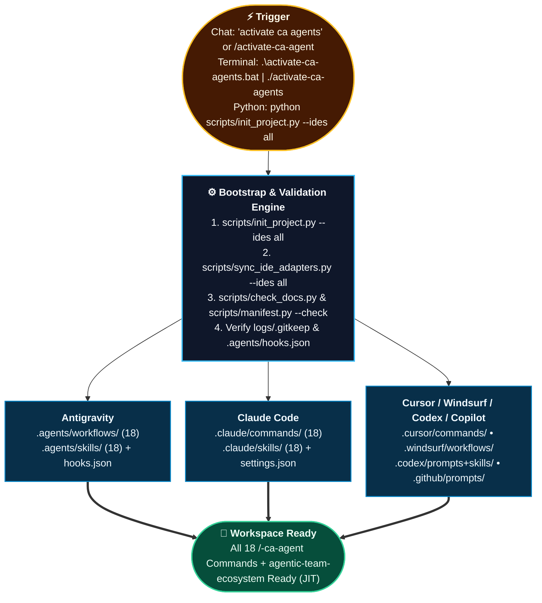

# SDD-Vibe Complete Activation Guide (`activate ca agents`)
### Zero-Conflict Bootstrap for All 18 Custom Slash Commands, `agentic-team-ecosystem`, IDE Adapters, Hooks & `.py` Scripts

<div align="center">

[](.)
[](.)
[](.)
[](LICENSE.md)

**Engineering Lead:** Chandan Adhikary · **Release:** SDD-Vibe 2.0.0 Universal

</div>

---

## 1. Why `"activate ca agents"`? (Zero-Conflict Design)

When you copy and rename `SDD-Vibe-Framework/` to your new project name (e.g., `citycare-hms/` or `my-saas-app/`), bare one-word commands often collide with built-in OS, shell, or Python tools:
- `activate` collides with Python virtual environments (`venv\Scripts\activate` / `source venv/bin/activate`).
- `start` collides with Windows PowerShell's built-in `Start-Process` alias.
- `run` / `/run` / `/plan` collide with built-in IDE slash commands.

Using **`activate ca agents`** (in chat), **`/activate-ca-agent`** (slash command), or **`activate-ca-agents`** (terminal wrapper) guarantees **zero collisions** on Windows, macOS, Linux, and every AI coding IDE—while keeping the underlying Python scripts (`scripts/init_project.py` and `scripts/sync_ide_adapters.py`) 100% workable.

---

## 2. All 3 Ways to Activate (Choose Any One)

### Method A: AI Agent Chat (Fastest — Zero Terminal Typing)
Open your renamed project folder at the **workspace root** in your IDE and type either:
```text
activate ca agents
```
or use the `/` autocomplete slash command:
```text
/activate-ca-agent
```
The AI agent automatically reads [`.agents/commands/activate-ca-agent.md`](SDD-Vibe-Framework/.agents/commands/activate-ca-agent.md) and runs the full idempotent bootstrap, `logs/` check, `check_docs.py`, and `manifest.py --check`.

---

### Method B: Terminal One-Command Wrapper (No `.py` Arguments Needed)
Open a terminal at your renamed project root and run:

- **Windows (PowerShell or CMD):**
  ```powershell
  .\activate-ca-agents.bat
  ```
  *(In CMD, `activate-ca-agents` also works without `.\`.)*

- **macOS / Linux (Bash / Zsh):**
  ```bash
  ./activate-ca-agents
  ```
  *(If needed on a fresh copy: `chmod +x activate-ca-agents` first.)*

You can also pass any `init_project.py` flag directly to the wrapper:
```powershell
.\activate-ca-agents.bat --clean-samples --install-git-hooks
.\activate-ca-agents.bat --dry-run
```

---

### Method C: Direct Python `.py` Scripts (Full Control / CI)
Both wrappers delegate to the standard-library Python scripts in `scripts/`:
```bash
# Full bootstrap across all 6 IDEs (Antigravity, Claude, Codex, Windsurf, Cursor, Copilot)
python scripts/init_project.py --ides all

# Sync specific IDEs only
python scripts/init_project.py --ides antigravity,claude,cursor

# Remove sample features (FEAT-001, FEAT-002, APR-SAMPLE-001) & install git pre-commit hook
python scripts/init_project.py --ides all --clean-samples --install-git-hooks

# Preview without writing any files
python scripts/init_project.py --ides all --dry-run

# Re-sync IDE adapters alone anytime
python scripts/sync_ide_adapters.py --ides all
```

---

## 3. What Gets Activated Under the Hood?



### Exact Breakdown of Synced Assets
1. **All `18` Collision-Free `*-ca-agent` Slash Commands:**
   - `/activate-ca-agent`, `/team-ecosystem-ca-agent`, `/plan-ca-agent`, `/task-ca-agent`, `/spec-check-ca-agent`, `/change-request-ca-agent`, `/testing-ca-agent`, `/tdd-ca-agent`, `/implement-ca-agent`, `/run-ca-agent`, `/review-ca-agent`, `/verify-ca-agent`, `/security-audit-ca-agent`, `/release-check-ca-agent`, `/dashboard-ca-agent`, `/errorlogs-ca-agent`, `/gitlogs-ca-agent`, `/handoff-ca-agent`.
2. **`agentic-team-ecosystem` + All `18` Skills:**
   - Discovered natively from `.agents/skills/` by Antigravity, Cursor, Windsurf, and Copilot, and copied into `.claude/skills/` (Claude Code) and `.codex/skills/` (Codex).
3. **Executable Lifecycle Hooks (`.agents/hooks.json` & `.claude/settings.json`):**
   - `SessionStart` (`scripts/hooks/session_start.py`): Checks workspace health and emits an `activation_hint` if IDE adapters are not yet synced.
   - `PreToolUse` (`scripts/hooks/pre_tool_guard.py`): Blocks dangerous/secret-leaking commands.
   - `PostToolUse` (`scripts/hooks/post_edit_check.py`): Validates doc/spec edits.
4. **Governance & Logging:**
   - Runs `python scripts/check_docs.py` (`0` errors) and `python scripts/manifest.py --check` (`186` files), and ensures `logs/` exists.

---

## 4. Registration vs. Execution (`activate ca agents` → `/team-ecosystem-ca-agent`)

> [!IMPORTANT]
> **Why `agentic-team-ecosystem` is registered at activation, not auto-expanded:**
> Loading all 14 team playbooks into your chat context before you even state your project domain would waste tokens.

- **`activate ca agents` (Step 0A — Registration):** Installs, syncs, and verifies all `18` slash commands and all `18` skills (including `agentic-team-ecosystem`) across your IDEs at **zero extra token cost**.
- **`/team-ecosystem-ca-agent` (Step 0B — Execution):** When you are ready to build, type `/team-ecosystem-ca-agent` (e.g., `/team-ecosystem-ca-agent saas` or `/team-ecosystem-ca-agent software`). **Team 14 (Manual Workflow Guider)** activates Step 0, classifies your domain, and guides you turn by turn with SDD-Vibe gates.

---

## 5. First 5 Minutes After Renaming `SDD-Vibe-Framework/`

1. **Copy & Rename:** Rename `SDD-Vibe-Framework/` to your project name (e.g., `citycare-hms/`) and open that folder as your IDE **workspace root**.
2. **Activate:** Type **`activate ca agents`** in chat (or run `.\activate-ca-agents.bat` / `./activate-ca-agents` in terminal).
3. **Optional Clean Start:** If you don't need the sample `FEAT-001` / `FEAT-002` specs, run:
   ```bash
   python scripts/init_project.py --clean-samples --install-git-hooks
   ```
4. **Launch Mission Control:** Type **`/dashboard-ca-agent`** in chat and open `http://127.0.0.1:4200` in the IDE Simple Browser.
5. **Start Building:** Type **`/team-ecosystem-ca-agent`** (or **`/plan-ca-agent`**) to begin Phase 1.

---

## 6. Troubleshooting & FAQ

- **Slash commands don't appear when typing `/`:**
  - Make sure you opened the **renamed project folder itself** as the IDE workspace root (not a parent folder containing multiple subfolders). IDEs discover `.agents/` at the workspace/git root.
- **Re-running activation after adding or editing files:**
  - `activate ca agents` and `init_project.py` are **100% idempotent**—re-running them safely refreshes IDE adapters without overwriting your `docs/product.md`, `docs/features/`, or application code.
- **Python not found on Windows:**
  - `activate-ca-agents.bat` automatically checks both `python` and `py -3`. Install Python 3.10+ if neither is on `PATH`.
