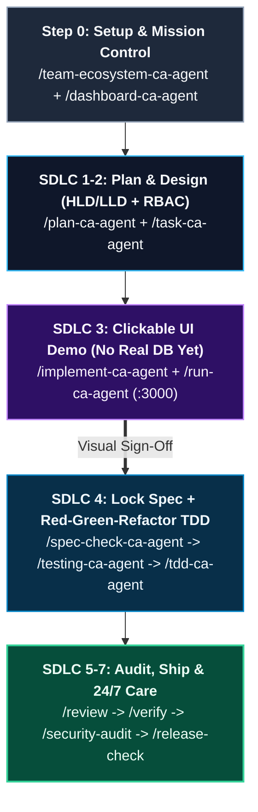

# Complete Layman-Friendly Guide: Role-Based Hospital Management System (HMS) Using SDLC & SDD-Vibe

<!-- SDD-VIBE-3D-DIAGRAM -->

**Framework:** SDD-Vibe (1-in-2 Single Workflow: Visual Prototype + Spec-Driven Development & TDD)  
**Reference Project:** CityCare Role-Based Hospital Management System (HMS)  
**Target Audience:** Anyone — founders, hospital admins, students, or developers — explained in plain English with exact `/-ca-agent` slash commands, GitHub/official skill & plugin references, and `"In Case of Scenario..."` walkthroughs.

---

## 1. Plain-English Overview: Building a Hospital System Like Building a Real Hospital

Imagine building a real hospital:
1. You **don't** start by pouring concrete and wiring X-ray machines without a floor plan.
2. First, you **talk to doctors, nurses, and receptionists** to list what rooms and rules are needed (**SDLC Planning**).
3. Next, you **draw the blueprint** and decide who gets keys to which rooms (**SDLC System Design & Role-Based Access Control**).
4. Then, you **build a clickable 3D model / model clinic** so staff can walk through the screens and approve the layout before any heavy plumbing is connected (**SDD-Vibe Phase 2: Frontend Sensory Demo**).
5. After everyone approves the screens, you **lock the safety rules**, write automated checks ("can a receptionist prescribe medicine? NO!"), and build the real database and security (**SDD-Vibe Phase 3: Spec Lock & TDD**).
6. Finally, you **inspect for leaks, run security scans, and open the doors**, while keeping a 24/7 logbook for repairs and future rooms (**SDD-Vibe Phase 4: Audit, Ship & Maintenance**).

---

## 2. Hospital Roles (RBAC — Who Can Do What?)

In a **Role-Based Hospital Management System**, every person logs in with a specific **Role**. The system strictly enforces what each role can see and do:

| Hospital Role | Plain-English Job | Can View / Do | Strictly Blocked From |
| :--- | :--- | :--- | :--- |
| **Admin** | Hospital Director / IT Lead | Manage staff accounts, departments, schedules, audit logs | Editing a Doctor's medical diagnosis directly |
| **Doctor** | Physician | View assigned patients, write diagnoses, order lab tests, issue prescriptions | Deleting audit logs or modifying billing invoices |
| **Nurse** | Ward / Triage Nurse | Record vitals (BP, temp), update ward bed status, view care notes | Issuing new prescriptions or deleting patient records |
| **Receptionist** | Front-Desk Staff | Register new patients, book appointments, print receipts | Viewing private clinical diagnoses or lab results |
| **Pharmacist** | Pharmacy Desk | View approved prescriptions, dispense medicine, update stock | Changing a Doctor's prescription or viewing billing |
| **Lab Technician** | Pathology / Diagnostics | View ordered lab tests, upload test reports | Prescribing medicine or editing patient demographics |
| **Patient** | Care Recipient | View own appointments, bills, and released lab reports | Seeing any other patient's data |

---

## 3. How SDLC Maps to SDD-Vibe Commands & GitHub/Official Skills

### Curated GitHub & Official Skills / Plugins Used Per Step (Optional, Developer Choice)
All external skills follow the **5-Point Security Vetting Checklist** in [`07-curated-external-skills-registry.md`](SDD-Vibe-Framework/.agents/skills/agentic-team-ecosystem/references/07-curated-external-skills-registry.md). Never load them randomly — use **Rank #1** per need at its exact gate:

| SDLC Stage | SDD-Vibe Slash Command | Core Repo Skill | External GitHub / Official Skill or Plugin (Rank #1) | Why This Skill Is Used Here |
| :--- | :--- | :--- | :--- | :--- |
| **Step 0 (Setup)** | `/team-ecosystem-ca-agent` | `agentic-team-ecosystem` | [`anthropics/skills`](https://github.com/anthropics/skills) · `claude-mem` | Cross-IDE skill baseline & persistent session memory |
| **Step 1 (Planning)** | `/plan-ca-agent` | `requirements-analysis`, `prd-writer` | `grill-me` *(GitHub Tier 3)* | Grills every hospital rule & edge case before coding |
| **Step 2 (Design)** | `/plan-ca-agent` → `/task-ca-agent` | `architecture-review`, `task-planner` | [`backnotprop/plannotator`](https://github.com/backnotprop/plannotator) · [`cathrynlavery/diagram-design`](https://github.com/cathrynlavery/diagram-design) · `serena` | Visual plan annotation, HLD/ER diagrams, symbol search |
| **Step 3 (UI Demo)** | `/implement-ca-agent` → `/run-ca-agent` | `ui-fidelity-review` | [`vercel-labs/agent-skills`](https://github.com/vercel-labs/agent-skills) · [`juxtopposed/realtimecolors`](https://github.com/juxtopposed/realtimecolors) · [`ibelick/motion-primitives`](https://github.com/ibelick/motion-primitives) | Clean Next.js/React UI, accessible color tokens, subtle motion |
| **Step 5 (TDD & E2E)** | `/spec-check-ca-agent` → `/testing-ca-agent` → `/tdd-ca-agent` | `spec-validator`, `tdd-enforcer`, `database-migration-review` | [`microsoft/playwright`](https://github.com/microsoft/playwright) | Real browser testing of Doctor, Nurse, Receptionist logins |
| **Step 6 (Security & QA)** | `/review-ca-agent` → `/verify-ca-agent` → `/security-audit-ca-agent` | `code-reviewer`, `security-auditor`, `accessibility-auditor` | [`gitleaks/gitleaks`](https://github.com/gitleaks/gitleaks) · [`semgrep/semgrep`](https://github.com/semgrep/semgrep) · [`aquasecurity/trivy`](https://github.com/aquasecurity/trivy) | Catches leaked API keys, OWASP flaws, and vulnerable packages |
| **Step 7–8 (Docs & Ship)** | `/handoff-ca-agent` → `/release-check-ca-agent` | `documentation-sync`, `release-validator` | `ppt-master` *(Phase-Gate)* | Executive/hospital stakeholder presentation & ship gate |

---

## 4. Granular Step-by-Step Walkthrough (SDLC Phases 0–7)

### Step 0: Open the Workshop & Turn On the Control Room
- **What you do:**
  1. Copy `SDD-Vibe-Framework/` and rename it to `citycare-hms/`.
  2. Open `citycare-hms/` in your IDE (Cursor, Antigravity, Windsurf, Claude Code, or VS Code).
  3. Sync IDE adapters (optional): `python scripts/sync_ide_adapters.py --ides all`.
  4. Type `/` in your AI chat box and confirm all **17 `*-ca-agent`** commands appear.
  5. Type `/dashboard-ca-agent` and open `http://127.0.0.1:4200` in the IDE Simple Browser.
  6. Type `/team-ecosystem-ca-agent saas` (or `software`) so **Team 14 (Manual Workflow Guider)** guides you turn by turn.
- **Plain-English Result:** Your live Mission Control dashboard is open on the side, showing active tasks, tests, logs (`logs/*.log`), and team progress.

---

### Step 1 (SDLC Phase 1 — Planning & Requirements): Ask Questions Before Building
- **Command to type:** `/plan-ca-agent`
- **What happens:** The AI enters **read-only planning mode** (it will NOT write app code yet). Using `requirements-analysis` (and optionally `grill-me`), it asks clarifying questions and defines:
  - `CAP-001`: Patient Registration & Front-Desk Triage
  - `CAP-002`: Role-Based Doctor Consultation & E-Prescription
  - `CAP-003`: Pharmacy Dispensing, Lab Reports & Billing
  - Privacy rules: HIPAA / patient-data isolation, audit logs for every record view.
- **Files updated:** `docs/product.md`, `docs/prd.md`, `docs/plan.md`, `docs/prompts.md`.

---

### Step 2 (SDLC Phase 2 — System Design & Task Breakdown): Draw the Blueprint
- **Commands to type:** `/plan-ca-agent` (review) → `/task-ca-agent`
- **What happens:**
  1. The AI designs the **High-Level & Low-Level Architecture** (`docs/system-architecture.md`) and **Visual Design Tokens** (`docs/design.md`), optionally using `cathrynlavery/diagram-design` for ER diagrams and `backnotprop/plannotator` so you can highlight/comment on the plan.
  2. `/task-ca-agent` breaks the work into small, numbered tasks in `docs/task.md`:
     - `TASK-001`: Hospital UI Demo (Role Switcher + Patient Registration + Doctor View)
     - `TASK-002`: Real Database, RBAC Guards & Patient Registration API
- **Plain-English Result:** You have a clear checklist and blueprint before a single line of code is written.

---

### Step 3 (SDLC Phase 3 — Frontend-First Sensory Demo): Build the Clickable Model Clinic
- **Commands to type:** `/implement-ca-agent` (UI shell) → `/run-ca-agent`
- **What happens:**
  1. The AI creates `docs/features/001-patient-registration.md` with `Status: PROTOTYPE` (then `DRAFT`).
  2. Using `vercel-labs/agent-skills` (and `juxtopposed/realtimecolors` for calm clinical colors), it builds the **frontend screens only** with realistic **mock data** (a Receptionist registration form, a Doctor queue, and a **Role Switcher** dropdown in the corner).
  3. `/run-ca-agent` starts the local app at `http://localhost:3000`.
- **What you check on screen:** Click around as Receptionist, Doctor, Nurse, and Patient. Does the layout feel clean on mobile and desktop? Are buttons clear?
- **Rule:** Do NOT touch PostgreSQL or real login tokens until you say *"The UI looks great, proceed!"*

---

### Step 4 (Kanban & Team Sync): Export Progress for Stakeholders
- **Command to type:** `/dashboard-ca-agent`
- **What happens:** Open `#ecosystem` in the dashboard (`http://127.0.0.1:4200`) and click **Export GSheet CSV** (`/api/kanban-export`) to share a clean task & sign-off sheet with hospital stakeholders.

---

### Step 5 (SDLC Phase 4 — Formal Spec Lock & TDD): Connect Real Database & Lock Security
- **Commands to type:** `/spec-check-ca-agent` → `/testing-ca-agent` → `/tdd-ca-agent`
- **What happens in order (never skip a step!):**
  1. **Spec Lock:** Change `docs/features/001-patient-registration.md` to `Status: APPROVED` and record approval in `docs/approvals/APR-001.md`. Run `/spec-check-ca-agent` to verify every rule (`AC-FEAT001-01`, `AC-FEAT001-02`, etc.) has a `Given / When / Then` scenario.
  2. **RED Phase (`/testing-ca-agent`):** The AI writes automated tests (including `microsoft/playwright` browser tests) **before** writing backend code, and runs them to prove they **fail** (`RED` in `logs/test.log`):
     - `TEST-FEAT001-01`: Receptionist can register a new patient (`201 Created`).
     - `TEST-FEAT001-02`: Receptionist trying to open Doctor clinical notes is blocked (`403 Forbidden`).
  3. **GREEN & REFACTOR Phase (`/tdd-ca-agent`):** The AI writes the minimal PostgreSQL schema, Row-Level Security (RLS), Zod input validation, and RBAC middleware until **100% of tests pass (`GREEN`)**, then cleans up the code.

---

### Step 6 (SDLC Phase 5 — Quality & Security Audit): The Safety Inspection
- **Commands to type:** `/review-ca-agent` → `/verify-ca-agent` → `/security-audit-ca-agent`
- **What happens:**
  - `/review-ca-agent`: Checks `git diff` to ensure no extra or unapproved files were touched.
  - `/verify-ca-agent`: Produces an objective scorecard proving every `AC-*` rule has a passing `TEST-*`.
  - `/security-audit-ca-agent`: Runs `gitleaks` (secret scan), `semgrep` (OWASP code scan), and `trivy` (dependency CVE scan) to guarantee zero leaked patient data or passwords.

---

### Step 7 & 8 (SDLC Phase 6 — Handoff & Production Ship): Open the Hospital Doors
- **Commands to type:** `/handoff-ca-agent` → `/release-check-ca-agent`
- **What happens:**
  - `/handoff-ca-agent` generates `docs/handoff.md` (and optional `ppt-master` deck) for the operations team.
  - `/release-check-ca-agent` runs `python scripts/check_docs.py`, `python scripts/manifest.py --check`, and verifies `docs/release-checklist.md` before giving the final **SHIP** verdict.

---

### Step 9 (SDLC Phase 7 — Maintenance & Monitoring): 24/7 Hospital Care
- **Commands to type:** `/errorlogs-ca-agent`, `/gitlogs-ca-agent`
- **What happens:** If any bug or slow query happens in production, `/errorlogs-ca-agent` reads `logs/error.log` and `docs/error-tracker.md` to pinpoint the exact line, write a regression test, and fix it safely.

---

## 5. "In Case of Scenario..." — Layman Troubleshooting & Real-World Playbook

### Scenario A: "What if a Receptionist tries to view or prescribe medicine?"
- **What happens in the system:**
  1. In **Phase 1–2**, the Role Matrix forbids Receptionists from accessing `/api/prescriptions` or clinical notes.
  2. In **Step 5 (`/testing-ca-agent`)**, we write `AC-FEAT002-03`:
     - *Given* a logged-in Receptionist, *When* they request `POST /api/prescriptions`, *Then* the server MUST return `403 Forbidden` and write an `auth.rbac_denied` audit log.
  3. In **Step 5 (`/tdd-ca-agent`)**, the RBAC guard is implemented until `TEST-FEAT002-03` turns `GREEN`.
  4. In **Step 6 (`/security-audit-ca-agent`)**, `semgrep` and `playwright` re-verify that no UI button or API route bypasses this check.

### Scenario B: "What if the Hospital Director asks for a brand-new 'Lab Report PDF Upload' feature mid-project?"
- **What to type (never just hack it in!):**
  1. If it changes an already-`APPROVED` feature, type `/change-request-ca-agent` first to log `CR-001` and check impact.
  2. Type `/team-ecosystem-ca-agent lab-report-upload` so **Team 14** guides the new feature cleanly through the exact same safe loop:
     `/plan-ca-agent` → `/task-ca-agent` → `docs/features/004-lab-upload.md` (`PROTOTYPE`) → `/implement-ca-agent` + `/run-ca-agent` (preview UI) → `/dashboard-ca-agent` (Kanban sync) → `/spec-check-ca-agent` (`APPROVED`) → `/testing-ca-agent` (`RED`) → `/tdd-ca-agent` (`GREEN`) → `/review-ca-agent` → `/security-audit-ca-agent`.

### Scenario C: "What if a test fails or the app crashes on a Doctor's screen?"
- **What to type:** `/errorlogs-ca-agent`
- **What happens:** The AI inspects `logs/error.log` and `docs/error-tracker.md`, finds the root cause (e.g., `ERR-005`), writes a failing reproduction test via `/testing-ca-agent`, fixes it with `/tdd-ca-agent`, and marks `ERR-005` as `RESOLVED` so it shows green in your Mission Control dashboard.

### Scenario D: "What if someone accidentally puts a database password or real patient phone number in code or logs?"
- **What happens:**
  1. `.agents/hooks.json` (`pre_tool_guard.py`) blocks unsafe writes before they happen.
  2. `/security-audit-ca-agent` (with `gitleaks`) scans the entire repo and `logs/*.log` and fails the release gate until the secret/PII is removed and rotated.