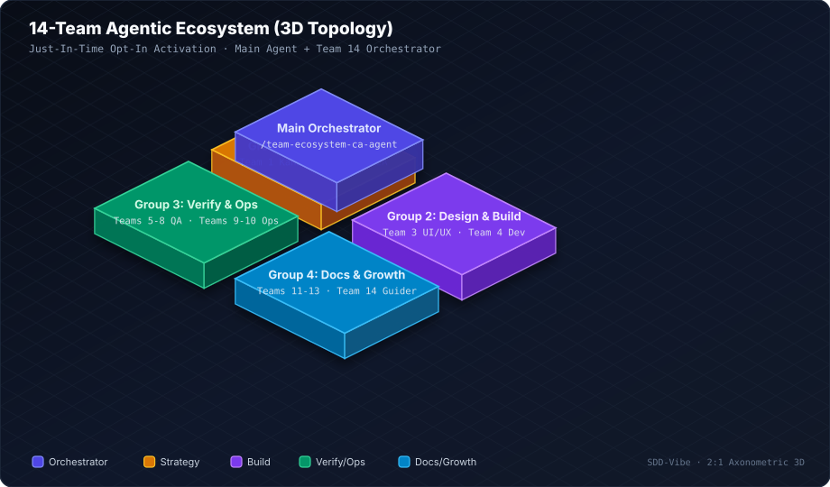

# SDD-Vibe External Skills Reference & Team Ownership Guide
### Complete Parameter Matrix, Rank #1 Critical Selection, Multi-Use Tiers & 14-Team Mapping

<!-- SDD-VIBE-3D-DIAGRAM -->

[-blue?style=for-the-badge)](SDD-Vibe-Framework/docs/skills.md)

**Engineering Lead:** Chandan Adhikary · **Release:** SDD-Vibe 2.0.0 Universal  
**Canonical Registry:** [07-curated-external-skills-registry.md](SDD-Vibe-Framework/.agents/skills/agentic-team-ecosystem/references/07-curated-external-skills-registry.md) · **Policy:** [docs/skills.md](SDD-Vibe-Framework/docs/skills.md)

---

## 1. Selection Criteria & Developer-Suggestion Protocol

All external skills in SDD-Vibe are **100% optional (Developer's Choice)**—never pre-bundled, never loaded randomly, and never installed from unverified forks. Every external skill is evaluated across **all 6 operational parameters** before an agent uses or suggests it:

| Parameter | How It Works in SDD-Vibe | Critical Rule |
| :--- | :--- | :--- |
| **1. Rank (`#1` Critical)** | Ordered within each sub-category by **Trust Tier → Cross-Harness Portability → Token Efficiency**. | **Always pick Rank `#1` by default.** Only fall back to `#2`/`#3` if `#1` lacks a required capability. Never load two overlapping skills in the same sub-category. |
| **2. Trust Tier** | `Tier 1` (Official vendor org), `Tier 2` (Established OSS), `Tier 3` (Community), `Reference` (Read-only). | **Tier 3** skills require the **5-Point Security Vetting Checklist** + sandbox dry-run before use. |
| **3. Multiple-Times Use** | `Every-Project Core` (reused across multiple projects & steps), `Phase-Gate` (at specific gates), `Domain-Intuition` (only when domain demands it). | Prioritize **Every-Project Core** skills for repeatable ROI; keep `Domain-Intuition` skills dormant until needed. |
| **4. Developer's Choice** | External skills are never forced or hardcoded into `.agents/`. | Core `.agents/skills/` + `*-ca-agent` commands always run first; external skills are strictly opt-in. |
| **5. Suggest to Developer/User** | **Mode 1:** Auto-Active (stack-native). **Mode 2:** Suggest **at most 1 Rank `#1`** skill at a matching gate and wait for `"yes"`. **Mode 3:** **Never auto-suggest**; developer-instructed only. | Always emit the **Transparent Skill Disclosure** before enabling: `Skill: <name> \| Ecosystem: <Core/Antigravity/Vercel/Claude/GitHub> \| Why Now: <phase & feature> \| Mode: <Mode 1 / Mode 2 (awaiting "yes") / Mode 3>` |
| **6. Belongs To (Team)** | Maps each skill to its owning Team(s) in the **4-Group / 14-Team** `agentic-team-ecosystem`. | Only the owning Team activates or suggests its mapped external skills at its designated SDLC step. |

### 5-Point Security Vetting Checklist (Before Installing Any External Skill)
1. **Verified Source:** Confirm official GitHub org / npm / vendor publisher (never unverified forks).
2. **Script & Prompt Inspection:** Read `SKILL.md`, `scripts/`, and hooks before execution.
3. **Least-Privilege Scope:** Run in sandboxed / least-privilege mode; never expose production secrets.
4. **No Spec Override:** External skills **MUST NOT** modify `APPROVED` specs or `docs/approvals/`.
5. **Clean Removal:** Revoke any granted tokens and clear cached data if uninstalled.

---

## 2. Rank #1 Critical Skills & Multi-Use Quick Table

Use this quick-reference table to see every **Rank `#1`** default external skill, whether it qualifies for **Multiple-Times Use**, how it is **suggested to the developer/user**, and which **Team** owns it:

| Category | Rank #1 Skill (Source) | Trust Tier | Multiple-Times Use | Developer's Choice & Suggest Policy | Belongs To (Team) | Primary Working Role |
| :--- | :--- | :--- | :--- | :--- | :--- | :--- |
| **A. Baseline Workflow** | `anthropics/skills` | Tier 1 | **Yes** (`Every-Project Core`) | **Mode 1/2** — Auto-active baseline or suggest at Step 0 | **Teams 2, 4, 14** | Official cross-IDE baseline skill patterns |
| **A. Grilling & Scoping** | `grill-me` | Tier 3 | Gate-based (`Phase-Gate`) | **Mode 2** — Suggest 1 at Step 1 if deep grilling needed | **Team 2, Team 14** | Relentless requirement & design-decision grilling |
| **A. Skill Discovery** | `find-skill` | Tier 3 | Gate-based (`Phase-Gate`) | **Mode 2** — Suggest at Step 2 when specialized skill needed | **Team 2** | Discovers & verifies official skills on demand |
| **A. Visual Plan Review** | `plannotator` (`backnotprop/plannotator`) | Tier 2 | **Yes** (Steps 2 & 6) | **Mode 2** — Suggest at Step 2 & Step 6 review gates | **Teams 1, 2, 7** | Local-first visual plan, spec & diff annotation UI |
| **A. Architecture Diagrams** | `diagram-design` (`cathrynlavery/diagram-design`) | Tier 3 | **Yes** (Steps 2 & 7) | **Mode 2** — Suggest when editorial HTML+SVG diagrams needed | **Team 2, Team 11** | 52+ editorial HTML+SVG diagrams (HLD/LLD/ER/UML) |
| **B. Persistent Memory** | `claude-mem` *(Cross-Harness)* | Tier 3 | **Yes** (`Every-Project Core`) | **Mode 2** — Suggest on large multi-session repos | **Teams 2, 4, 14** | Persistent cross-session memory paired with `docs/memory.md` |
| **B. Code Intelligence** | `serena` | Tier 2 | **Yes** (`Every-Project Core`) | **Mode 2** — Suggest on large multi-module codebases | **Team 2, Team 4** | Semantic symbol-level code retrieval & editing |
| **B. Reverse Engineering** | `REA` *(Reverse Engineering Anything)* | Tier 3 | Domain (`Domain-Intuition`) | **Mode 3** — **Never auto-suggest**; developer-instructed | **Team 2 (REA)** | Reverse-engineers legacy apps, APIs, or binaries |
| **B. AI Agent Pipelines** | `dify` / `openhands` | Tier 2 | Domain (`Domain-Intuition`) | **Mode 2/3** — Suggest only on AI/LLM agent builds | **Team 4 (AI Stack)** | Builds LLM agent pipelines & autonomous workflows |
| **C. Web / React Craft** | `vercel-labs/agent-skills` | Tier 1 | **Yes** (`Every-Project Core`) | **Mode 1/2** — Auto-active on React/Next.js/Vercel stacks | **Team 3, Team 4 (UI)** | Official React/Next.js performance & UI best practices |
| **C. UI Component Kit** | `21st` (21st.dev) / `mantine` | Tier 2/3 | Domain (`Domain-Intuition`) | **Mode 2** — Suggest at Step 3 if UI kit accelerates demo | **Team 3** | Production UI blocks (`21st`) or full app suite (`mantine`) |
| **C. Motion & Spring UI** | `motion-dev` / `motion-primitives` | Tier 2 | Domain (`Domain-Intuition`) | **Mode 3** — Developer-instructed for micro-interactions | **Team 3** | Spring physics (`motion`) & accessible Tailwind motion |
| **C. Color & Typography** | `Realtime-color` (`juxtopposed/realtimecolors`) | Tier 2 | Gate-based (`Phase-Gate`) | **Mode 2** — Suggest at Step 3 visual token setup | **Team 3, Team 13** | Live palette/typography preview & CSS/Tailwind token export |
| **C. Data Visualization** | `recharts` | Tier 2 | Domain (`Domain-Intuition`) | **Mode 2** — Suggest when building analytics/BI dashboards | **Team 3, Team 12** | Responsive React charts for SaaS, ML & BI metrics |
| **C. 3D Hero Scenes** | `react-spline` | Tier 3 | Domain (`Domain-Intuition`) | **Mode 3** — **Never auto-suggest**; developer-instructed | **Team 3** | Interactive 3D hero scenes (only when 3D adds value) |
| **D. E2E Browser Testing** | `playwright` (`microsoft/playwright`) | Tier 1 | **Yes** (`Every-Project Core`) | **Mode 2** — Suggest at Step 5–6 for E2E verification | **Team 5, Team 8** | Deterministic E2E, cross-browser & visual regression tests |
| **E. Secret Leak Scan** | `gitleaks` | Tier 1 | **Yes** (`Every-Project Core`) | **Mode 2** — Suggest at pre-commit & Step 6 security gate | **Team 6** | Fast pre-commit & repo-wide secret leak detection |
| **E. SAST Security Scan** | `semgrep` | Tier 1 | Gate-based (`Phase-Gate`) | **Mode 2** — Suggest at Step 6 (`/security-audit-ca-agent`) | **Team 6** | OWASP Top 10 & injection static analysis (SAST) |
| **F. Pitch & Arch Decks** | `ppt-master` | Tier 3 | Gate-based (`Phase-Gate`) | **Mode 2** — Suggest at Step 7 for executive/client decks | **Team 11** | Client pitch decks, architecture slides & executive PPTs |
| **F. Technical SEO / GEO** | `claude-seo` | Tier 3 | Domain (`Domain-Intuition`) | **Mode 3** — Developer-instructed for SaaS/E-commerce GTM | **Team 13** | Technical SEO, AEO & GEO (`llms.txt`) audits |
| **F. WhatsApp Gateway** | `OpenWA` (`rmyndharis/OpenWA` / `open-wa`) | Tier 2/3 | Domain (`Domain-Intuition`) | **Mode 3** — **Never auto-suggest**; developer-instructed | **Team 13, Team 4** | Self-hosted WhatsApp REST/webhook gateway (human-approved sends) |

---

## 3. Master External Skills Catalog (All Parameters Viewed)

### Category A — Discovery, Grilling, Planning & Meta-Workflow

| Sub-Category | Rank | External Skill (Source) | Trust Tier | Multiple-Times Use | Developer's Choice & Suggest Policy | Belongs To (Team & Group) | Brief Working Details |
| :--- | :---: | :--- | :--- | :--- | :--- | :--- | :--- |
| **Baseline Workflow** | **#1** | `anthropics/skills` *(Official)* | Tier 1 | **Every-Project Core** (Multi-use) | **Mode 1 / 2** — Auto-active baseline or suggest at Step 0 | **Team 2, Team 4, Team 14** *(Groups 1, 2, Orchestrator)* | Provides portable baseline skill patterns across Claude, Codex, Antigravity, and Cursor. |
| **Baseline Workflow** | #2 | `superpowers` | Tier 2 | **Every-Project Core** (Multi-use) | **Mode 2** — Fallback only if `#1` lacks structured TDD flow | **Team 2, Team 4, Team 5** *(Groups 1, 2, 3)* | Enforces structured brainstorming, planning, and TDD discipline. |
| **Baseline Workflow** | #3 | `andrej-karpathy` skill | Tier 2 | `Domain-Intuition` | **Mode 3** — Developer-instructed only | **Team 4, Team 7** *(Groups 2, 3)* | Applies minimal-complexity coding and strict verification discipline. |
| **Grilling & Scoping** | **#1** | `grill-me` | Tier 3 | `Phase-Gate` (Step 1) | **Mode 2** — Suggest 1 at Step 1 (`/plan-ca-agent`) | **Team 2, Team 14** *(Group 1, Orchestrator)* | Relentlessly grills requirements and design decisions before any code is written. |
| **Grilling & Scoping** | #2 | `ai-weekend-build` / `gstack` | Tier 3 | `Domain-Intuition` | **Mode 3** — Fallback for rapid founder-mode sprints | **Team 2, Team 4** *(Groups 1, 2)* | Accelerates rapid MVP scoping and time-boxed execution sprints. |
| **Skill Discovery** | **#1** | `find-skill` | Tier 3 | `Phase-Gate` (Step 2) | **Mode 2** — Suggest at Step 2 when niche capability needed | **Team 2** *(Group 1)* | Discovers and verifies official external skills on demand instead of guessing. |
| **Skill Discovery** | #2 | `awesome-skills` / `skillopt` | Tier 3 | `Domain-Intuition` | **Mode 3** — Fallback for skill discovery & token audit | **Team 2, Team 14** *(Group 1, Orchestrator)* | Curates external skills and audits prompt/token efficiency. |
| **Visual Plan Review** | **#1** | `plannotator` (`backnotprop/plannotator`) | Tier 2 | `Phase-Gate` (Steps 2 & 6) | **Mode 2** — Suggest at Step 2 plan & Step 6 review gates | **Team 1, Team 2, Team 7** *(Groups 1, 3)* | Local-first visual plan, spec, and diff annotation UI with structured feedback loops. |
| **Architecture Diagrams** | **#1** | `diagram-design` (`cathrynlavery/diagram-design`) | Tier 3 | `Phase-Gate` (Steps 2 & 7) | **Mode 2** — Suggest when editorial HTML+SVG visuals needed | **Team 2, Team 11** *(Groups 1, 4)* | Generates 52+ zero-dependency editorial HTML+SVG diagrams (HLD/LLD/DFD/UML/ER/Sankey). |
| **Meta-Orchestration** | #3 | `ponytail` / `i-have-adhd` / `bla` / `hallmark` / `godmod` / `openclaw` / `ruflo` / `claude-octopus` | Tier 3 | `Domain-Intuition` | **Mode 3** — **Never auto-suggest**; developer-instructed | **Team 14** *(Orchestrator)* | Specialized meta-workflow helpers; must adapt to `.agents/` contracts. |

---

### Category B — Cross-Harness Memory, Code Intelligence & Reverse Engineering

| Sub-Category | Rank | External Skill (Source) | Trust Tier | Multiple-Times Use | Developer's Choice & Suggest Policy | Belongs To (Team & Group) | Brief Working Details |
| :--- | :---: | :--- | :--- | :--- | :--- | :--- | :--- |
| **Persistent Memory** | **#1** | `claude-mem` *(Cross-Harness Adapter)* | Tier 3 | **Every-Project Core** (Multi-use) | **Mode 2** — Suggest on large multi-session repositories | **Team 2, Team 4, Team 14** *(Groups 1, 2, Orchestrator)* | Persists session memory across harnesses when paired with `docs/memory.md` and `logs/`. |
| **Code Intelligence** | **#1** | `serena` | Tier 2 | **Every-Project Core** (Multi-use) | **Mode 2** — Suggest on large multi-module codebases | **Team 2, Team 4** *(Groups 1, 2)* | Performs semantic, symbol-level code retrieval and precise refactoring edits. |
| **Code Intelligence** | #2 | `graphify` | Tier 2 | `Domain-Intuition` | **Mode 2/3** — Fallback for visual dependency graphs | **Team 2** *(Group 1)* | Builds knowledge and dependency graphs for architectural mapping. |
| **Reverse Engineering** | **#1** | `REA` *(Reverse Engineering Anything)* | Tier 3 | `Domain-Intuition` | **Mode 3** — **Never auto-suggest**; developer-instructed | **Team 2 (REA Agent)** *(Group 1)* | Reverse-engineers legacy codebases, undocumented APIs, or binaries into specs. |
| **CLI Wrapping** | #2 | `cli-anything` / `EEC` | Tier 3 | `Domain-Intuition` | **Mode 3** — Developer-instructed only | **Team 4** *(Group 2)* | Wraps repetitive workflows or APIs into deterministic CLI commands. |
| **AI Agent Pipelines** | **#1** | `dify` / `openhands` | Tier 2 | `Domain-Intuition` (Step 5) | **Mode 2** — Suggest only when building AI/LLM agent apps | **Team 4 (AI Stack)** *(Group 2)* | Scaffolds and orchestrates LLM agent pipelines and autonomous workflows. |
| **Agent Workspaces** | #2 | `OpenBot` (`CopilotKit/OpenBot` / `nightly-labs/openbot`) | Tier 2/3 | `Domain-Intuition` | **Mode 3** — **Never auto-suggest**; developer-instructed | **Team 4 (AI Stack)** *(Group 2)* | Self-hostable MCP agent workspace (`CopilotKit`) or local-first persistent task runner (`nightly-labs`). |
| **Multi-Agent Sim** | #3 | `Mirofish` | Tier 3 | `Domain-Intuition` | **Mode 3** — Developer-instructed only | **Team 2, Team 4** *(Groups 1, 2)* | Runs multi-agent simulation and scenario modeling for complex systems. |

---

### Category C — Frontend Design, UI Kits, Motion & Data Visualization

| Sub-Category | Rank | External Skill (Source) | Trust Tier | Multiple-Times Use | Developer's Choice & Suggest Policy | Belongs To (Team & Group) | Brief Working Details |
| :--- | :---: | :--- | :--- | :--- | :--- | :--- | :--- |
| **Web / React Craft** | **#1** | `vercel-labs/agent-skills` | Tier 1 | **Every-Project Core** (Multi-use) | **Mode 1 / 2** — Auto-active on React/Next.js/Vercel stacks | **Team 3, Team 4 (UI)** *(Group 2)* | Official React/Next.js performance, routing, and UI engineering best practices. |
| **Web / React Craft** | #2 | `ui-ux-pro-max` / `impeccable` | Tier 3 | `Domain-Intuition` | **Mode 2** — Fallback when `#1` needs extra UI polish rules | **Team 3** *(Group 2)* | High-craft UI/UX design system rules and visual hierarchy polish. |
| **Web / React Craft** | #3 | `emilkowalski` / `awesome-design-skill` | Tier 3 | `Domain-Intuition` | **Mode 3** — Developer-instructed for tactile micro-UX | **Team 3** *(Group 2)* | Curated design patterns and tactile micro-interaction polish. |
| **UI Component Kits** | **#1** | `21st` (21st.dev) / `mantine` | Tier 2/3 | `Domain-Intuition` (Step 3) | **Mode 2** — Suggest at Step 3 (`21st` hero, `mantine` full app) | **Team 3** *(Group 2)* | Production React/Tailwind component library for rapid sensory demos. |
| **UI Component Kits** | #2 | `glass-ui` (`AndreyBegma/glass-ui` / `alexburlis/glassyui`) | Tier 3 | `Domain-Intuition` (Step 3) | **Mode 3** — **Never auto-suggest**; developer-instructed | **Team 3** *(Group 2)* | Frosted/Liquid Glass React+Tailwind primitives (never mix with flat/brutalist kits). |
| **UI Component Kits** | #3 | `kokonut-ui` / `bklit-ui` | Tier 3 | `Domain-Intuition` | **Mode 3** — Developer-instructed only | **Team 3** *(Group 2)* | Lightweight animated React/Tailwind UI primitives. |
| **Motion & Physics** | **#1** | `motion-dev` / `motion-primitives` (`ibelick/motion-primitives`) | Tier 2 | `Domain-Intuition` (Step 3) | **Mode 3** — Developer-instructed for motion-rich UIs | **Team 3** *(Group 2)* | Spring physics, layout animations, and copy-paste accessible React micro-interactions. |
| **Motion & Physics** | #2 | `anime.js` / `reanimate` | Tier 2/3 | `Domain-Intuition` | **Mode 3** — Developer-instructed for SVG/video motion | **Team 3** *(Group 2)* | Timeline/SVG choreography (`anime.js`) or programmatic video (`reanimate`). |
| **Color & Typography** | **#1** | `Realtime-color` (`juxtopposed/realtimecolors`) | Tier 2 | `Phase-Gate` (Step 3) | **Mode 2** — Suggest at Step 3 visual token setup | **Team 3, Team 13** *(Groups 2, 4)* | Live palette/typography playground exporting CSS & Tailwind tokens for `docs/design.md`. |
| **Data Visualization** | **#1** | `recharts` | Tier 2 | `Domain-Intuition` (Steps 3 & 9) | **Mode 2** — Suggest when building analytics/BI dashboards | **Team 3, Team 12** *(Groups 2, 4)* | Composable React charts for SaaS analytics, ML metrics, and BI dashboards. |
| **3D Hero Scenes** | **#1** | `react-spline` | Tier 3 | `Domain-Intuition` (Step 3) | **Mode 3** — **Never auto-suggest**; developer-instructed | **Team 3** *(Group 2)* | Embeds interactive 3D Spline scenes (only when 3D adds clear product value). |
| **SVG Backgrounds** | `Ref` | `Haikei` (`haikei.app`) | Reference | `Domain-Intuition` (Steps 3 & 7) | **Mode 2** — Reference when custom SVG waves/blobs needed | **Team 3, Team 13** *(Groups 2, 4)* | Generates organic SVG waves, blobs, and gradient backgrounds for web & brand pages. |
| **UI Benchmarking** | `Ref` | `Mobbin` / `Dribbble` | Reference | `Phase-Gate` (Step 3) | **Mode 2** — Read-only visual pattern research | **Team 3** *(Group 2)* | Visual pattern benchmarking and layout inspiration before Step 3 UI build. |

---

### Category D — Browser Automation & Testing

| Sub-Category | Rank | External Skill (Source) | Trust Tier | Multiple-Times Use | Developer's Choice & Suggest Policy | Belongs To (Team & Group) | Brief Working Details |
| :--- | :---: | :--- | :--- | :--- | :--- | :--- | :--- |
| **E2E Browser Testing** | **#1** | `playwright` (`microsoft/playwright`) | Tier 1 | **Every-Project Core** (Multi-use) | **Mode 2** — Suggest at Step 5–6 for E2E & regression | **Team 5, Team 8** *(Group 3)* | Deterministic cross-browser E2E tests, screenshots, and visual regression (`logs/test.log`). |
| **Headless Recon** | #2 | `obscura` (`h4ckf0r0day/obscura`, `obscura-mcp`) | Tier 3 | `Domain-Intuition` (Steps 1, 5, 6) | **Mode 3** — **Never auto-suggest**; owned targets only | **Team 5, Team 6** *(Group 3)* | Lightweight Rust/V8 CDP headless browser (~30MB RAM); never use to bypass auth/CAPTCHAs. |
| **UI Demo Inspection** | #3 | `agent-browser` | Tier 3 | `Domain-Intuition` (Step 3) | **Mode 2** — Fallback for lightweight Step 3 UI checks | **Team 3, Team 5** *(Groups 2, 3)* | Lightweight agent-driven browser inspection during Phase 2 sensory demo. |
| **Test Generation** | #4 | `test-skill` | Tier 3 | `Domain-Intuition` | **Mode 3** — Fallback when framework defaults are insufficient | **Team 5** *(Group 3)* | Generates supplementary edge-case tests when standard harnesses need coverage boost. |

---

### Category E — Security Testing, SAST & Secrets Scanning

| Sub-Category | Rank | External Skill (Source) | Trust Tier | Multiple-Times Use | Developer's Choice & Suggest Policy | Belongs To (Team & Group) | Brief Working Details |
| :--- | :---: | :--- | :--- | :--- | :--- | :--- | :--- |
| **Secret Scanning** | **#1** | `gitleaks` | Tier 1 | **Every-Project Core** (Multi-use) | **Mode 2** — Suggest at pre-commit & Step 6 security gate | **Team 6** *(Group 3)* | Fast pre-commit and repo-wide secret/API-key leak detection. |
| **Secret Scanning** | #2 | `trufflehog` (`trufflesecurity/trufflehog`) | Tier 1 | `Phase-Gate` (Step 6) | **Mode 2** — Fallback/companion for deep git history | **Team 6** *(Group 3)* | Deep git-history scanning with live credential verification. |
| **SAST Analysis** | **#1** | `semgrep` | Tier 1 | `Phase-Gate` (Step 6) | **Mode 2** — Suggest at Step 6 (`/security-audit-ca-agent`) | **Team 6** *(Group 3)* | Static analysis (SAST) for OWASP Top 10, SQLi, XSS, and auth flaws. |
| **CVE & Container Scan** | #2 | `trivy` (`aquasecurity/trivy`) | Tier 1 | `Phase-Gate` (Step 6) | **Mode 2** — Suggest alongside `semgrep` for containers/deps | **Team 6** *(Group 3)* | Scans Docker images, OS packages, and dependency lockfiles for CVEs. |
| **AI Security Review** | #3 | `security-audit-skill` / `strix` / `sigma` / `awesome-security` | Tier 3 | `Domain-Intuition` | **Mode 3** — Developer-instructed only | **Team 6** *(Group 3)* | AI-assisted security review and detection ruleset augmentation. |
| **Defensive Wordlists** | `Ref` | `SecLists` / `PayloadsAllTheThings` | Tier 2 | `Domain-Intuition` | **Mode 3** — **Never auto-suggest**; owned staging only | **Team 6** *(Group 3)* | Authorized defensive fuzzing/security testing reference against owned staging targets. |

---

### Category F — Documentation, SEO, Growth & Distribution

| Sub-Category | Rank | External Skill (Source) | Trust Tier | Multiple-Times Use | Developer's Choice & Suggest Policy | Belongs To (Team & Group) | Brief Working Details |
| :--- | :---: | :--- | :--- | :--- | :--- | :--- | :--- |
| **Pitch & Arch Decks** | **#1** | `ppt-master` | Tier 3 | `Phase-Gate` (Step 7) | **Mode 2** — Suggest at Step 7 (pair with `diagram-design`) | **Team 11** *(Group 4)* | Generates client pitch decks, architecture slides, and executive PPTs. |
| **Repo Presentation** | #2 | `github-profile-readme-maker` | Tier 3 | `Domain-Intuition` | **Mode 3** — Developer-instructed only | **Team 11, Team 13** *(Group 4)* | Polishes repository and organization `README.md` presentation. |
| **Technical SEO / GEO** | **#1** | `claude-seo` | Tier 3 | `Domain-Intuition` (Steps 7 & 9) | **Mode 3** — Developer-instructed for SaaS/E-commerce GTM | **Team 13** *(Group 4)* | Audits technical SEO, AEO, and AI search readiness (`llms.txt`). |
| **WhatsApp Gateway** | **#1** | `OpenWA` (`rmyndharis/OpenWA` / `open-wa`) | Tier 2/3 | `Domain-Intuition` (Steps 5, 7, 9) | **Mode 3** — **Never auto-suggest**; human-approved sends only | **Team 13, Team 4** *(Groups 4, 2)* | Self-hosted WhatsApp REST/webhook gateway with strict Team 6 session isolation. |
| **Social Distribution** | #2 | `postiz-app` | Tier 3 | `Domain-Intuition` (Step 9) | **Mode 3** — **Never auto-suggest**; developer-instructed | **Team 13** *(Group 4)* | Schedules social distribution (LinkedIn/IG/FB) after explicit human approval. |

---

## 4. Team-by-Team Ownership Matrix (Teams 1–14)

Use this reverse-lookup table to see **which external skills belong to each Team** and when that Team suggests them to the developer/user:

| Team | Group | Rank #1 Primary External Skill(s) | Optional Fallback (`#2` / `#3` / `Ref`) | Suggest-to-User Timing |
| :--- | :--- | :--- | :--- | :--- |
| **Team 1** *(PM / Kanban)* | Group 1 | `plannotator` | — | Step 2 & Step 4 plan/task visual review (**Mode 2**) |
| **Team 2** *(Research / Arch / REA)* | Group 1 | `anthropics/skills`, `grill-me`, `find-skill`, `plannotator`, `diagram-design`, `claude-mem`, `serena`, `REA` *(Mode 3)* | `superpowers`, `ai-weekend-build`, `awesome-skills`, `graphify`, `Mirofish` | Steps 1–2 discovery, grilling, and architecture gates (**Mode 2**; `REA` **Mode 3**) |
| **Team 3** *(UI / UX / Brand)* | Group 2 | `vercel-labs/agent-skills`, `21st`/`mantine`, `motion-dev`/`motion-primitives`, `Realtime-color`, `recharts`, `react-spline` *(Mode 3)* | `ui-ux-pro-max`, `emilkowalski`, `glass-ui` *(Mode 3)*, `kokonut-ui`, `anime.js`, `Haikei`, `Mobbin`, `agent-browser` | Step 3 Frontend Sensory Demo (`vercel-labs` **Mode 1/2**; visual kits **Mode 2/3**) |
| **Team 4** *(Core Dev / AI / OS)* | Group 2 | `anthropics/skills`, `claude-mem`, `serena`, `dify`/`openhands`, `vercel-labs` *(UI)*, `OpenWA` *(Mode 3)* | `superpowers`, `andrej-karpathy`, `ai-weekend-build`, `cli-anything`, `OpenBot` *(Mode 3)*, `Mirofish` | Step 3 (UI) & Step 5 (TDD/AI/Backend) (**Mode 1/2**; `OpenBot`/`OpenWA` **Mode 3**) |
| **Team 5** *(Testing)* | Group 3 | `playwright` | `superpowers`, `obscura` *(Mode 3)*, `agent-browser`, `test-skill` | Step 6 Gate 1 E2E & cross-browser suite (**Mode 2**) |
| **Team 6** *(Security Testing)* | Group 3 | `gitleaks`, `semgrep` | `trufflehog`, `trivy`, `obscura` *(Mode 3)*, `security-audit-skill`, `SecLists` *(Mode 3)* | Pre-commit & Step 6 Gate 2 SAST/secret/CVE audit (**Mode 2**; `SecLists`/`obscura` **Mode 3**) |
| **Team 7** *(Code Review)* | Group 3 | `plannotator` | `andrej-karpathy` *(Mode 3)* | Step 6 Gate 3 diff & spec-traceability review (**Mode 2**) |
| **Team 8** *(Quality Assurance)* | Group 3 | `playwright` | — | Step 6 Gate 4 visual regression & QA scorecard (**Mode 2**) |
| **Team 9** *(Deployment Ops)* | Group 3 | *(Uses Core `release-validator` + Team 6 `trivy`)* | — | Step 8 container/infra CVE check via Team 6 |
| **Team 10** *(24×7 Maintenance)* | Group 3 | *(Uses Core `debugging-analyst` + `logs/`)* | — | Step 9 incident triage; escalates code fixes to Team 4 |
| **Team 11** *(Documentation)* | Group 4 | `diagram-design`, `ppt-master` | `github-profile-readme-maker` | Step 7 handoff docs, architecture diagrams & pitch decks (**Mode 2**) |
| **Team 12** *(BI / ROI / Finance)* | Group 4 | `recharts` | — | Step 1 ROI charts & Step 9 BI analytics (**Mode 2**) |
| **Team 13** *(Marketing / GEO)* | Group 4 | `Realtime-color`, `claude-seo` *(Mode 3)*, `OpenWA` *(Mode 3)* | `Haikei`, `github-profile-readme-maker`, `postiz-app` *(Mode 3)* | Steps 1, 7 & 9 Brand/SEO/GTM (**Mode 3** developer-instructed for outreach/SEO) |
| **Team 14** *(Workflow Guider)* | Orchestrator | `anthropics/skills`, `grill-me`, `claude-mem` | `awesome-skills`/`skillopt`, meta-orchestration helpers *(Mode 3)* | Steps 0–9 continuous guidance & Transparent Skill Disclosure (**Mode 1/2**) |
