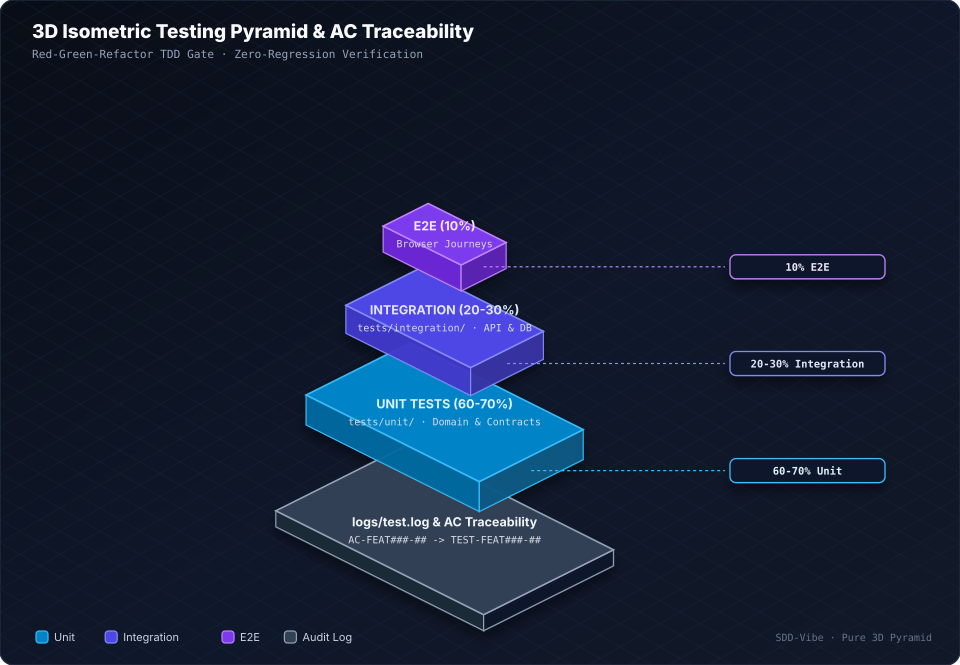

# /errorlogs-ca-agent

<!-- SDD-VIBE-3D-DIAGRAM -->

**Purpose:** Analyze recurring errors from safe logs and link regression preventative tests.

## When to run

**MUST** invoke only for a task whose intent and permissions match this command.

## Inputs

- **MUST** capture task ID, goal, guideline baseline, applicable approved spec/version, acceptance IDs and allowed files.
- **MUST** identify required tools and human approval for destructive, external or production effects.

## Procedure

1. **MUST** read `AGENTS.md` and the relevant `docs/` source of truth.
2. **MUST** inspect existing artifacts and identify missing approvals or conflicts.
3. **MUST** perform only the approved operation: Analyze recurring errors from safe logs and link regression preventative tests.
   - **Log Triage Classification:** Separate **External Bot/Scanner Probes** (e.g., automated 404/403 hits to `.env`, `.git/config`, `wp-login.php`, `phpinfo.php`, or path traversal) from **Application Regressions** (5xx traces, unhandled exceptions, latency spikes). Recommend rate-limiting/WAF rules for scanner bursts while linking actual application defects to `docs/error-tracker.md` and regression tests.
4. **MUST** run applicable objective checks; never invent execution results.
5. **MUST** report changed files, actual results, deviations and next authorized action.

## Stop conditions

**MUST** stop on an unauthorized feature, baseline conflict, credential exposure, failed blocking gate, or missing approval.