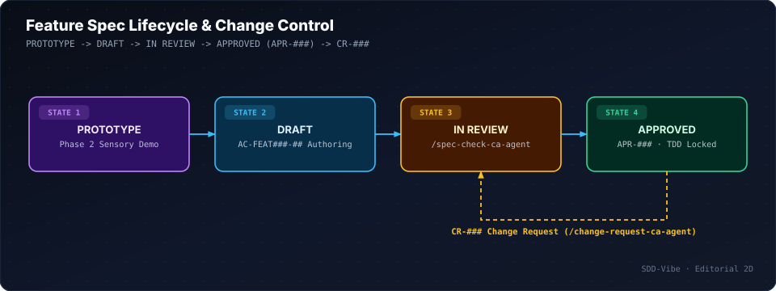

# /plan-ca-agent

<!-- SDD-VIBE-3D-DIAGRAM -->

**Purpose:** Analyze scope, requirements, dependencies and risks; propose a bounded plan; obtain approval before production implementation.

## When to run

**MUST** invoke only for a task whose intent and permissions match this command.

## Inputs

- **MUST** capture task ID, goal, guideline baseline, applicable approved spec/version, acceptance IDs and allowed files.
- **MUST** identify required tools and human approval for destructive, external or production effects.

## Procedure

1. **MUST** read `AGENTS.md`, `docs/skills.md`, and the relevant `docs/` source of truth (`docs/domains/`, `docs/product.md`, `docs/system-architecture.md`).
2. **MUST** execute **Pre-Start Pin-Point Grilling & Domain Research** (via `requirements-analysis`) before proposing any architecture, `docs/prd.md`, or `FEAT-###` spec:
   - **Research & Domain Verification:** Verify industry vocabulary, business rules, regulatory/compliance baselines (e.g., GDPR, HIPAA, PCI-DSS, WCAG, OWASP), and technical constraints. Tag every claim `[VERIFIED: <source>]` or `[ASSUMPTION — NEEDS CONFIRMATION]`.
   - **Adaptive Pin-Point Grilling:** Challenge vague or missing requirements across 6 dimensions: *(1) Problem & Personas, (2) Core Flows & Edge Cases, (3) Scale / Latency / Cost Budget, (4) Data Ownership, Security & Compliance, (5) Failure Modes & Rollback, (6) Explicit Non-Goals*. Use **1-question-at-a-time** for single critical architectural forks, or a **focused batch (3–5 pin-point questions)** for independent baseline dimensions.
   - **Zero-Confusion Skill Disclosure:** Consult `docs/skills.md` and `07-curated-external-skills-registry.md` if a specialized skill is needed; suggest **at most 1 Rank #1** external skill with `Skill | Ecosystem | Why Now | Consent Mode` and never load silently.
3. **MUST** inspect existing artifacts and identify missing approvals, conflicts, or `[ASSUMPTION]` items.
4. **MUST** output a **Domain & Ambiguity Scorecard** (`0` unresolved `CRITICAL` blockers required) and propose a bounded plan; obtain explicit developer approval before production implementation or Phase 2/3 transition.
5. **MUST** run applicable objective checks; never invent execution results.
6. **MUST** report changed files, actual results, deviations, `[ASSUMPTION]` items, and next authorized action.

## Stop conditions

**MUST** stop on an unresolved `CRITICAL` ambiguity, unverified domain assumption affecting security/data/architecture, unauthorized feature, baseline conflict, credential exposure, failed blocking gate, or missing approval.