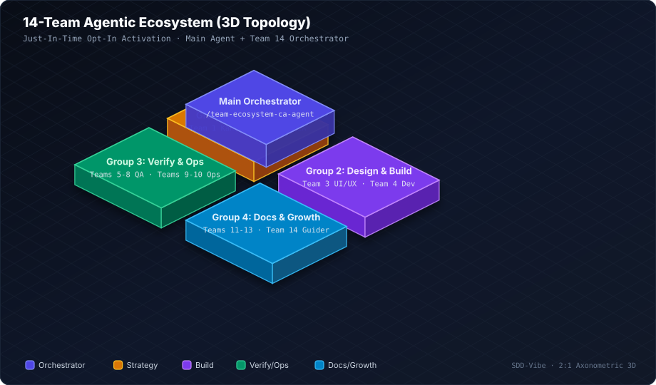

# 07 — Curated, Trust-Tiered & Zero-Confusion Universal Skills Registry

<!-- SDD-VIBE-3D-DIAGRAM -->

**Policy:** All external skills, MCPs, and packages listed here are **optional (Developer Choice)** per `docs/skills.md`. Never pre-bundle, never load randomly, and **never install from unverified forks**. Always verify the official GitHub org / npm / Vercel / Anthropic source, pass the **5-Point Security Vetting Checklist** ([02-discovery-design-dev-teams.md](02-discovery-design-dev-teams.md)), and emit the **Transparent Skill Disclosure** (`Skill | Ecosystem | Why Now | Mode`) before enabling.

---

## 0. Zero-Confusion Universal Feature-to-Skill & Timing Router

Use this single table to know **with 0 confusion** which skill (Core, **Antigravity**, **Vercel**, **Claude**, or **GitHub**) applies to a feature at a **particular time**, vs. which ones wait for **Developer Instruction**:

| Feature / Need | Exact Phase / Time | Core / Antigravity Native | External Rank #1 (Claude / Vercel / GitHub) | Activation Mode | Never Mix With |
|---|---|---|---|---|---|
| **Pre-Start Grilling & Domain Research** | Phase 1 / Step 1 (`/plan-ca-agent`) | `requirements-analysis` | `grill-me` *(GitHub, Tier 3)* | **Mode 2** (Suggest 1 if deep grilling needed) | Unverified guesses |
| **Claude Code Automation Setup** | Phase 1 / Step 0 (Claude Code) | `.agents/` + `activate-ca-agent` | `claude-code-setup` *(Anthropic `claude-plugins-official`, Tier 1)* | **Mode 2** (Suggest at Step 0 for Claude Code) | Conflicting manual hooks |
| **Visual & Adversarial Plan Review** | Phase 1–3 / Steps 2 & 6 | `architecture-review`, `spec-validator` | `plannotator` *(GitHub `backnotprop/plannotator`, Tier 2)* / `elephant-goldfish-model` *(Google, Tier 1)* | **Mode 2** (Suggest at Step 2/6 gate) | Silent plan edits |
| **Architecture & System Diagrams** | Phase 1 & 4 / Steps 2 & 7 | Mermaid in `docs/system-architecture.md` | `diagram-design` *(GitHub `cathrynlavery/diagram-design`, Tier 3)* | **Mode 2** (Suggest when editorial HTML+SVG needed) | Duplicate text-only diagrams |
| **React / Next.js / Vercel Web Craft** | Phase 2–3 / Steps 3 & 5 | Antigravity `modern-web-guidance` | `vercel-labs/agent-skills` *(Vercel, Tier 1)* | **Mode 1/2** (Auto-active on Next.js/Vercel stack) | Legacy React patterns |
| **Cloud / Mobile / AI Platform Stacks** | Phase 2–3 / Steps 3 & 5 | Antigravity `firebase-*`, `flutter-*`, `gemini-api-*`, `bigquery-*` | `anthropics/skills` *(Claude, Tier 1)* | **Mode 1** (Active only when that stack is in repo) | Cross-platform conflicting SDKs |
| **UI Color, Typography & SVG Assets** | Phase 2 / Step 3 (Sensory Demo) | `ui-fidelity-review` | `Realtime-color` *(GitHub, Tier 2)* / `Haikei` *(Ref)* | **Mode 2** (Suggest at Step 3 visual setup) | Hardcoded ad-hoc hex codes |
| **UI De-Slop, Brand Logo & Pixel VFX** | Phase 2 / Step 3 (Sensory Demo) | `ui-fidelity-review` | `unslop` (`heydamir/unslop`), `logo-design` (`kaankiziltug/logo-design-skill`), `pixelfx` (`patch-gg/pixelfx`) *(Tier 3)* | **Mode 3** (**Developer-Instructed Only**) | Mixing conflicting visual kits |
| **UI Motion / Glassmorphism / 3D** | Phase 2 / Step 3 (Sensory Demo) | `ui-fidelity-review` | `motion-primitives` *(GitHub, Tier 2)*; `glass-ui` / `react-spline` *(Tier 3)* | **Mode 3** (**Developer-Instructed Only**) | Mixing glassmorphism + brutalist kits |
| **Browser Perf, LCP & A11y Audit** | Phase 2 & 4 / Steps 3 & 6 | Antigravity `chrome-devtools`, `a11y-debugging`, `accessibility-auditor`, `performance-profiler` | `playwright` *(GitHub/MS, Tier 1)* | **Mode 1** (Antigravity native) / **Mode 2** (`playwright` for E2E) | `obscura` + `playwright` together |
| **Web/Social Research (No API Key)** | Phase 1 & 4 / Steps 1 & 7 | `search_web` | `Agent-Reach` *(GitHub `Panniantong/Agent-Reach`, Tier 3)* | **Mode 3** (**Developer-Instructed Only**) | Auth/CAPTCHA bypass |
| **Headless Recon / Owned-Staging** | Phase 3–4 / Steps 5 & 6 | — | `obscura` *(GitHub `h4ckf0r0day/obscura`, Tier 3)* | **Mode 3** (**Developer-Instructed Only**, owned targets) | Auth/CAPTCHA bypass |
| **SAST, Secrets & Dependency CVEs** | Phase 4 / Step 6 (`/security-audit-ca-agent`) | `security-auditor` | `gitleaks` (secrets) + `semgrep` (SAST) + `trivy` (CVEs) *(Tier 1)* | **Mode 2** (Suggest per audit type) | `SecLists` unless developer instructs |
| **Cross-Session Memory & Symbol Search** | Any Phase (Large Repo) | `docs/memory.md` (Memory Lanes) | `serena` *(Tier 2)* / `claude-mem` *(Tier 3, cross-harness)* | **Mode 2** (Suggest only on large multi-session repos) | Unscoped global memory dumps |
| **Reverse Engineering / WhatsApp / Bot / Social** | Domain-Specific | — | `REA`, `OpenWA`, `OpenBot`, `postiz-app`, `claude-seo`, `ppt-master` | **Mode 3** (**Developer-Instructed Only**, except `ppt-master` at Step 7) | Unapproved external sends |

---

## 1. Intuition, Frequency & Category-Ranking Rules

1. **No Random Loading:** Activate **at most 1–3 external tools/skills per step**, strictly matched to the project's domain and current bottleneck.
2. **Frequency Tiers:**
   - **Every-Project Core:** High-frequency baseline tools needed on almost every web/software build.
   - **Phase-Gate:** Triggered only at specific gates (Discovery, Security Audit, Docs/Release).
   - **Domain-Intuition / Developer-Instructed:** Triggered only when the domain demands it or the developer explicitly instructs it.
3. **Unambiguous Sub-Category Ranking (One `#1` per Sub-Category):** Within each sub-category below, there is **exactly one Rank `#1`** ordered by **Trust Tier → Cross-Harness Portability → Token Efficiency**. **Use Rank `#1` by default**; only fall back to `#2` or `#3` if `#1` lacks a required capability. Never load two overlapping tools of the same sub-category at once.

---

## 2. Trust Tiers

| Tier | Source Standard | Verification Requirement |
|---|---|---|
| **Tier 1 (Official / Vendor)** | Official vendor orgs (`anthropics/skills`, `anthropics/claude-plugins-official` (`claude-code-setup`), `google/elephant-goldfish-model`, `vercel-labs/agent-skills`, `vercel-labs/skills`, `upstash/context7`, `microsoft/playwright`, `semgrep`, `aquasecurity/trivy`, `gitleaks`, `trufflesecurity/trufflehog`) | Verify exact org/package name; standard lockfile/checksum check |
| **Tier 2 (Established OSS)** | Well-known open-source ecosystems (`superpowers`, `serena`, `graphify`, `openhands`, `dify`, `paperclipai/paperclip`, `21st-dev/magic-mcp`, `alibaba/open-code-review`, `CopilotKit/OpenBot`, `mantine`, `recharts`, `anime.js`, `motion.dev`, `ibelick/motion-primitives`, `backnotprop/plannotator`, `juxtopposed/realtimecolors`, `open-wa/wa-automate-nodejs`, `SecLists`, `PayloadsAllTheThings`) | Verify official repo & license; read scripts before running |
| **Tier 3 (Trending / Community)** | Specialized community skills & tools (`grill-me`, `claude-mem`, `ui-ux-pro-max`, `find-skill`, `cathrynlavery/diagram-design`, `AndreyBegma/glass-ui`, `alexburlis/glassyui`, `h4ckf0r0day/obscura`, `rmyndharis/OpenWA`, `nightly-labs/openbot`, `haikei.app`, `heydamir/unslop`, `elayadesign/ai-design-skills`, `kaankiziltug/logo-design-skill`, `patch-gg/pixelfx`, `Panniantong/Agent-Reach`, `DeadInternetStudios/100x-engineer-skill`, `elementalsouls/Claude-BugHunter`) | **Mandatory 5-Point Security Vetting Checklist** + sandbox dry-run before use |

---

## 3. Ranked Category Catalog (Select Rank #1 per Need)

### A. Discovery, Grilling, Planning & Meta-Workflow (Team 1, Team 2, Team 14)

| Sub-Category | Rank | Tool / Skill | Tier | Frequency | Trigger Intuition & Cross-Harness Note |
|---|---|---|---|---|---|
| **Baseline Workflow** | **#1** | `anthropic` skills (`anthropics/skills`) | Tier 1 | Every-Project Core | Official baseline skill patterns; portable across Claude, Codex, Antigravity, Cursor |
| **Baseline Workflow** | **#2** | `superpowers` | Tier 2 | Every-Project Core | Structured brainstorming, planning, and TDD discipline |
| **Baseline Workflow** | **#3** | `andrej-karpathy` skill | Tier 2 | Domain-Intuition | Minimal-complexity coding & verification discipline |
| **Grilling & Scoping** | **#1** | `grill-me` | Tier 3 | Phase-Gate (Step 1) | **Team 2 + Team 14:** Relentless requirement & design-decision grilling before coding |
| **Grilling & Scoping** | **#2** | `ai-weekend-build` / `gstack` | Tier 3 | Domain-Intuition | Rapid MVP scoping & founder-mode execution sprints |
| **Skill Discovery** | **#1** | `find-skill` / `vercel-labs/skills` (`skills.sh`) | Tier 1/3 | Phase-Gate (Step 2) | **Team 2:** Discover & install official Agent Skills (`npx skills find` / `npx skills add`) on demand |
| **Claude Code Setup** | **#1** | `claude-code-setup` (`anthropics/claude-plugins-official`) | Tier 1 | Phase-Gate (Step 0) | **Team 2 & Team 14:** Analyzes codebase to recommend Claude Code hooks, skills, and MCP servers |
| **Skill Discovery** | **#2** | `awesome-skills` / `skillopt` | Tier 3 | Domain-Intuition | Skill discovery & prompt/token optimization auditing |
| **Visual Plan Review** | **#1** | `plannotator` (`backnotprop/plannotator`) | Tier 2 | Phase-Gate (Steps 2 & 6) | **Team 1, Team 2, Team 7:** Local-first visual plan, spec & diff annotation UI with structured feedback loop across Claude, Codex, Gemini CLI & Cursor |
| **Adversarial Spec Review** | **#2** | `elephant-goldfish-model` (`google/elephant-goldfish-model`) | Tier 1 | Phase-Gate (Step 2) | **Team 2 & Team 7:** Long-horizon `Elephant` spec drafter + zero-context `Goldfish` adversarial reviewer to prevent context-rot & confirmation bias |
| **Architecture Diagrams** | **#1** | `diagram-design` (`cathrynlavery/diagram-design`) | Tier 3 | Phase-Gate (Steps 2 & 7) | **Team 2 & Team 11:** Zero-dependency editorial HTML+SVG diagrams (52+ types: HLD/LLD/DFD/UML/ER/Sankey; imports Mermaid/draw.io/PlantUML) |
| **Verification Ledger** | **#2** | `100x-engineer-skill` (`DeadInternetStudios/100x-engineer-skill`) | Tier 3 | Domain-Intuition | **Team 4, Team 5, Team 7:** Formal state/invariant mapping (`verify/ledger.tsv`) and multi-model review rounds |
| **Agent Control Plane** | **#1** | `paperclip` (`paperclipai/paperclip`) | Tier 2 | Domain-Intuition | **Team 1 & Team 14:** Open-source multi-agent control plane (virtual org charts, BYOA adapters, token budgets, heartbeats, approval gates) |
| **Meta-Orchestration** | **#3** | `ponytail` / `i-have-adhd` / `bla` / `hallmark` / `godmod` / `openclaw` / `ruflo` / `claude-octopus` | Tier 3 | Domain-Intuition | Specialized workflow/orchestration helpers; adapt `.agents/` contracts for all harnesses |

---

### B. Cross-Harness Memory, Code Intelligence & Reverse Engineering (Team 2 & Team 4)

| Rank | Tool / Skill | Tier | Frequency | Trigger Intuition & Cross-Harness Note |
|---|---|---|---|---|
| **#1** | `claude-mem` *(Cross-Harness Adapter)* | Tier 3 | Every-Project Core | Persistent session memory; pair with `docs/memory.md` + `logs/` so it works for **Claude, Codex, Antigravity, Cursor, Windsurf**—not Claude-only |
| **#1** | `serena` | Tier 2 | Every-Project Core | Semantic symbol-level code retrieval & editing for large codebases |
| **#1** | `Context7` (`upstash/context7` / `@upstash/context7-mcp`) | Tier 1 | Every-Project Core | **Team 2 & Team 4:** Live, version-specific library docs & code examples via MCP (`resolve-library-id`, `query-docs`) |
| **#2** | `graphify` | Tier 2 | Domain-Intuition | Knowledge/dependency graph visualization & architectural mapping |
| **#1** | `REA` (Reverse Engineering Anything) | Tier 3 | Domain-Intuition | **Team 2 (REA Agent):** Reverse-engineer legacy apps, APIs, or binaries |
| **#2** | `cli-anything` / `EEC` | Tier 3 | Domain-Intuition | Wrap workflows/APIs into deterministic CLIs |
| **#1** | `dify` / `openhands` | Tier 2 | Domain-Intuition | **Team 4 (AI Stack):** Trigger only when building LLM agent pipelines or autonomous workflows |
| **#2** | `OpenBot` (`CopilotKit/OpenBot` / `nightly-labs/openbot`) | Tier 2/3 | Domain-Intuition | **Team 4 (AI Stack & Agent Workspaces):** Self-hostable MCP agent workspace with human-in-the-loop governance (`CopilotKit/OpenBot`) or local-first persistent task-agent runner (`nightly-labs/openbot`) |
| **#3** | `Mirofish` | Tier 3 | Domain-Intuition | Multi-agent simulation & scenario modeling |
| **#3** | `Agent-Reach` (`Panniantong/Agent-Reach`) | Tier 3 | Domain-Intuition | **Team 2 & Team 13:** Zero-API-key multi-platform web & social search/scrape skill + MCP (Twitter/X, Reddit, YouTube, GitHub, LinkedIn, RSS, Jina/Exa); never bypass auth/CAPTCHAs |

---

### C. Frontend Design, UI Kits, Motion & Data Visualization (Team 3)

| Rank | Tool / Skill | Tier | Frequency | Trigger Intuition (Pick 1 per Sub-Need) |
|---|---|---|---|---|
| **#1** | `vercel-labs` skills / `modern-web-guidance` | Tier 1 | Every-Project Core | Official React/Next.js/Web best practices & performance |
| **#2** | `ui-ux-pro-max` / `impeccable` | Tier 3 | Domain-Intuition | High-craft UI/UX design system & polish rules |
| **#3** | `emilkowalski` skill / `awesome-design-skill` | Tier 3 | Domain-Intuition | Micro-interactions, tactile UI feel, and curated design patterns |
| **#3** | `unslop` (`heydamir/unslop`) | Tier 3 | Domain-Intuition | Redline UI & copy review that scrubs generic "AI slop" (purple gradients, boilerplate tags) from vibecoded interfaces |
| **#3** | `ai-design-skills` (`elayadesign/ai-design-skills`) | Tier 3 | Domain-Intuition | Structured `landing-page-design` skill (offer/CTA intake, page architecture, typography, spacing, and accessibility rules) |
| **#1** | `21st` (`21st-dev/magic-mcp` / `21st.dev`) / `mantine` | Tier 2/3 | Domain-Intuition | Production component library & unified **21st MCP** (`@21st-dev/magic` for marketing/UI blocks; `mantine` for full app suite) |
| **#2** | `glass-ui` (`AndreyBegma/glass-ui` / `alexburlis/glassyui`) | Tier 3 | Domain-Intuition | Glassmorphism / Liquid Glass React + Tailwind UI primitives (use only when frosted/glass surfaces fit the brand; never mix with flat/brutalist kits) |
| **#3** | `kokonut-ui` / `bklit-ui` | Tier 3 | Domain-Intuition | Lightweight animated React/Tailwind UI primitives |
| **#1** | `motion-dev` (`motion`) / `motion-primitives` (`ibelick/motion-primitives`) | Tier 2 | Domain-Intuition | Spring physics & layout animations (`motion-dev`) + copy-paste accessible React/Tailwind micro-interactions (`motion-primitives`) |
| **#2** | `anime.js` (`anime`) / `reanimate` | Tier 2/3 | Domain-Intuition | Timeline/SVG choreography (`anime.js`) or programmatic video/motion (`reanimate`) |
| **#1** | `Realtime-color` (`juxtopposed/realtimecolors`) | Tier 2 | Phase-Gate (Step 3) | Live UI color palette & typography playground with CSS/Tailwind token export for Team 3 & Team 13 |
| **#1** | `recharts` | Tier 2 | Domain-Intuition | Data dashboards, SaaS analytics, ML/business charts |
| **#1** | `react-spline` | Tier 3 | Domain-Intuition | Interactive 3D hero scenes (only when 3D adds clear product value) |
| **#2** | `logo-design` (`kaankiziltug/logo-design-skill`) | Tier 3 | Domain-Intuition | Structured SVG brand & logo design (1,400+ offline SVG refs, geometric construction, optical/squint/pixel tests) |
| **#3** | `pixelfx` (`patch-gg/pixelfx`) | Tier 3 | Domain-Intuition | Code-driven pixel-art VFX & sprite sheet generator (Godot, Unity, Phaser, HTML5 Canvas) |
| **Ref** | `Haikei` (`haikei.app`) | Reference | Domain-Intuition (Steps 3 & 7) | Organic SVG background, wave, blob, and gradient asset generator for React/Next.js & brand pages |
| **Ref** | `Mobbin` / `Dribbble` | Reference | Phase-Gate (Step 3) | Visual inspiration & pattern benchmarking (read-only research) |

---

### D. Browser Automation & Testing (Team 5 & Team 8)

| Rank | Tool / Skill | Tier | Frequency | Trigger Intuition |
|---|---|---|---|---|
| **#1** | `playwright` | Tier 1 | Every-Project Core | Deterministic E2E, cross-browser, and visual regression testing |
| **#2** | `obscura` (`h4ckf0r0day/obscura`, `obscura-mcp`, `obscura-plugin`) | Tier 3 | Domain-Intuition (Steps 1, 5, 6) | Lightweight Rust/V8 CDP headless browser (~30MB RAM) for fast research & owned-staging checks (**Team 6 authorized-targets only**; never bypass auth/CAPTCHAs) |
| **#3** | `agent-browser` | Tier 3 | Domain-Intuition | Lightweight agent-driven browser inspection during Phase 2 sensory demo |
| **#4** | `test-skill` | Tier 3 | Domain-Intuition | Supplementary test-case generation when framework defaults are insufficient |

---

### E. Security Testing, SAST & Secrets Scanning (Team 6)

| Rank | Tool / Skill | Tier | Frequency | Trigger Intuition |
|---|---|---|---|---|
| **#1** | `gitleaks` | Tier 1 | Every-Project Core | Fast pre-commit & repo-wide secret leak detection |
| **#2** | `trufflehog` | Tier 1 | Phase-Gate (Step 6) | Deep git-history & verified credential scanning |
| **#1** | `semgrep` | Tier 1 | Phase-Gate (Step 6) | Static analysis (SAST) for OWASP Top 10 & injection flaws |
| **#2** | `trivy` | Tier 1 | Phase-Gate (Step 6) | Container, OS package, and dependency CVE scanning |
| **#2** | `open-code-review` (`alibaba/open-code-review`) | Tier 2 | Phase-Gate (Step 6) | **Team 7 & Team 6:** Hybrid deterministic + LLM line-level code review (`ocr` CLI) for NPEs, thread-safety, XSS & SQLi |
| **#3** | `security-audit-skill` / `strix` / `sigma` / `awesome-security` | Tier 3 | Domain-Intuition | AI-assisted security review & detection rules |
| **#3** | `Claude-BugHunter` (`elementalsouls/Claude-BugHunter`) | Tier 3 | Domain-Intuition | **Team 6 authorized-targets only:** 85 skills, 16 commands, 681 vulnerability patterns across 24 classes (never bypass auth/CAPTCHAs) |
| **Ref** | `SecLists` / `PayloadsAllTheThings` | Tier 2 | Domain-Intuition | **Authorized defensive testing only** against owned staging targets |

---

### F. Documentation, SEO, Growth & Distribution (Team 11 & Team 13)

| Rank | Tool / Skill | Tier | Frequency | Trigger Intuition |
|---|---|---|---|---|
| **#1** | `ppt-master` | Tier 3 | Phase-Gate (Step 7) | **Team 11:** Client pitch decks, architecture slides, and executive PPTs (pair with `diagram-design` for editorial architecture visuals) |
| **#2** | `github-profile-readme-maker` | Tier 3 | Domain-Intuition | Polished repository/org `README.md` presentation |
| **#1** | `claude-seo` | Tier 3 | Domain-Intuition | **Team 13:** Technical SEO, AEO, and GEO audits for SaaS/E-commerce |
| **#1** | `OpenWA` (`rmyndharis/OpenWA` / `open-wa/wa-automate-nodejs`) | Tier 2/3 | Domain-Intuition (Steps 5, 7, 9) | **Team 13 & Team 4:** Self-hosted WhatsApp REST/webhook gateway & automation toolkit (**human-approved sends only**; strict Team 6 session/credential isolation) |
| **#2** | `postiz-app` | Tier 3 | Domain-Intuition | **Team 13:** Scheduled social distribution (LinkedIn/IG/FB) after human approval |