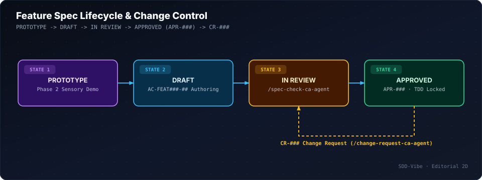

# 08 — Production, Security, GEO & Store Publishing Checklists

<!-- SDD-VIBE-3D-DIAGRAM -->

**Scope:** Concrete, actionable verification checklists for **Team 4 (Dev)**, **Team 6 (Security)**, **Team 8 (QA)**, **Team 9 (Deployment Ops)**, and **Team 13 (Growth & Store)**. Inspired by practical indie-to-production engineering playbooks; all items are **framework-agnostic** and **Developer Choice**.

---

## 1. 27-Point Pre-Launch Security Audit (Team 4 & Team 6)

Run before any public or production release (complementing `docs/security.md` and `/security-audit-ca-agent`):

### Secrets & Repository Hygiene
1. **No hardcoded secrets** in source, tests, or config—all keys loaded via environment/secret store.
2. **`.env` gitignored** and `.env.example` contains placeholder values only.
3. **Git history scanned** (`gitleaks` / `trufflehog`) for accidentally committed keys in prior commits.
4. **Logs PII/secret redacted**—verify `logs/*.log` never record tokens, passwords, cookies, or raw PII.
5. **Client bundle audit**—ensure no server-only or admin API keys are exposed in frontend JS/mobile builds.

### Authentication, Sessions & 2FA Edge Cases
6. **Server-side session/JWT validation**—signature, `exp`, `iss`, `aud` verified on every protected request.
7. **HttpOnly, Secure, SameSite cookies** for browser sessions; short-lived access tokens + rotated refresh tokens.
8. **Admin 2FA/MFA enforced** for all privileged/staff accounts—no role bypasses.
9. **2FA Edge Case #1 (Recovery/Backup Codes):** Backup codes are hashed at rest, single-use, and invalidated upon rotation.
10. **2FA Edge Case #2 (Enrollment & Session Binding):** Enabling/disabling 2FA requires current password + valid OTP and invalidates all other active sessions.
11. **Brute-force & credential-stuffing protection**—rate-limiting + exponential backoff on login, OTP, and password-reset endpoints.
12. **Password reset tokens**—cryptographically random, single-use, short TTL (≤ 15 min), invalidated after use.

### Authorization, Input & File Upload Safety
13. **Server-side RBAC/ABAC & IDOR checks**—every resource read/write verifies ownership or role on the backend.
14. **Parameterized queries / ORM bindings**—zero string-concatenated SQL or NoSQL operator injection.
15. **XSS & CSP protection**—output encoding, sanitized rich text, strict `Content-Security-Policy`.
16. **CSRF protection** on state-changing cookie-authenticated endpoints.
17. **SSRF protection**—allowlist outbound URLs/domains and block private/metadata IP ranges (`169.254.169.254`).
18. **Hidden File Extension & Upload Safety:** Reject deceptive double extensions (e.g., `.jpg.exe`, `.pdf.js`), validate **magic bytes** (not just `Content-Type` or filename), enforce max file size, and store uploads outside executable web roots with randomized names.

### API, Payments, Bot Defense & Recovery
19. **Strict CORS allowlist**—never reflect arbitrary `Origin` headers with `Access-Control-Allow-Credentials: true`.
20. **Rate limiting & bot defense** on public endpoints, forms, and AI/LLM inference routes (preventing wallet-draining).
21. **Payment webhook verification**—verify cryptographic webhook signatures (Stripe/Razorpay/etc.) and enforce **idempotency keys** so duplicate events never double-credit.
22. **Server-side price & entitlement calculation**—never trust client-submitted totals, discounts, or tier flags.
23. **Security headers enabled** (`HSTS`, `X-Content-Type-Options: nosniff`, `X-Frame-Options` / `frame-ancestors`).
24. **Dependency & container CVE scan** (`npm audit` / `pip-audit` / `trivy`) with zero unresolved `CRITICAL`/`HIGH` findings.
25. **Error responses sanitized**—no stack traces, SQL errors, or internal paths returned to clients.
26. **Automated encrypted DB backups** tested with a documented restore drill (`docs/runbook.md`).
27. **Admin/internal routes isolated**—protected by auth + IP/VPN/2FA, never discoverable via unauthenticated enumeration.

---

## 2. Pre-Launch Production & Free-Tier Stack Matrix (Team 9)

When launching MVPs or indie/SaaS apps with minimal burn, evaluate free/low-cost tiers against `docs/tech-stacks.md` constraints:

| Layer | Free / Indie-Friendly Tier Pattern | Production Gate Before Scaling |
|---|---|---|
| **Web / Frontend Hosting** | Edge static + SSR platforms (e.g., Vercel, Cloudflare Pages, Netlify) | Custom domain, HTTPS, preview environments, cache headers |
| **Backend / Workers** | Container/PaaS free or low-cost tiers (e.g., Render, Fly.io, Cloud Run, Cloudflare Workers) | Health check (`/healthz`), graceful shutdown, cold-start budget |
| **Database & Auth** | Managed Postgres / BaaS (e.g., Supabase, Neon, Firebase, Turso) | Connection pooling, automated backups, Row-Level Security (RLS) |
| **Bot Defense & CDN** | Edge WAF / Turnstile / rate-limiting proxy (e.g., Cloudflare Free) | Rate limits on auth/AI routes, bot-probe 404/403 filtering |
| **Monitoring & Logs** | Structured JSON logs in `logs/` + free-tier error/uptime alerts (e.g., Sentry, UptimeRobot) | Alerting on 5xx spikes, latency SLOs, disk/quota thresholds |

---

## 3. AI-Agent Discoverability (GEO) Checklist (Team 3 & Team 13)

Ensure public web apps and SaaS sites are natively discoverable, readable, and citable by AI search engines and agents (ChatGPT, Perplexity, Claude, Gemini):

1. **`llms.txt` (and optional `llms-full.txt`):** Serve a concise `/llms.txt` at the site root summarizing product purpose, key documentation links, pricing/API endpoints, and canonical URLs in clean Markdown.
2. **Markdown Content Negotiation (Optional for Docs/Blogs):** Support `Accept: text/markdown` or `.md` URL variants on documentation/resource pages so AI agents ingest clean text without HTML boilerplate.
3. **Structured Data (JSON-LD):** Include valid `Schema.org` JSON-LD (`SoftwareApplication`, `Organization`, `FAQPage`, `Article`) on landing and docs pages.
4. **Semantic HTML & Crawler Access:** Verify `robots.txt` intentionally allows/disallows AI crawlers per policy, and `sitemap.xml` is fresh and linked.
5. **Citation-Ready Fact Blocks:** Provide clear, verifiable product claims, benchmarks, and pricing tables in plain text/HTML (not trapped inside images or canvas).

---

## 4. Mobile & Google Play Publishing & ASO Gate (Team 5, Team 8 & Team 13)

Required before submitting Android/mobile builds to production stores:

1. **Signed Release Artifact:** Signed `.aab` (App Bundle) with Play App Signing enabled and ProGuard/R8 mapping uploaded.
2. **Closed Testing Readiness:** Meet store closed-testing requirements (e.g., 12+ opted-in testers for 14 continuous days on personal developer accounts) with real feedback logged.
3. **Data Safety & Permissions Parity:** Every SDK/permission in `AndroidManifest.xml` / `Info.plist` matches the Store Data Safety & Privacy Policy declarations.
4. **Reviewer Access:** Provide working, non-expiring demo credentials (and 2FA bypass/test OTP instructions) in Store Review Notes.
5. **Android Vitals & Store Assets:** Crash rate < 1.09%, ANR rate < 0.47%, localized title/short description/screenshots, and A/B listing experiment configured.