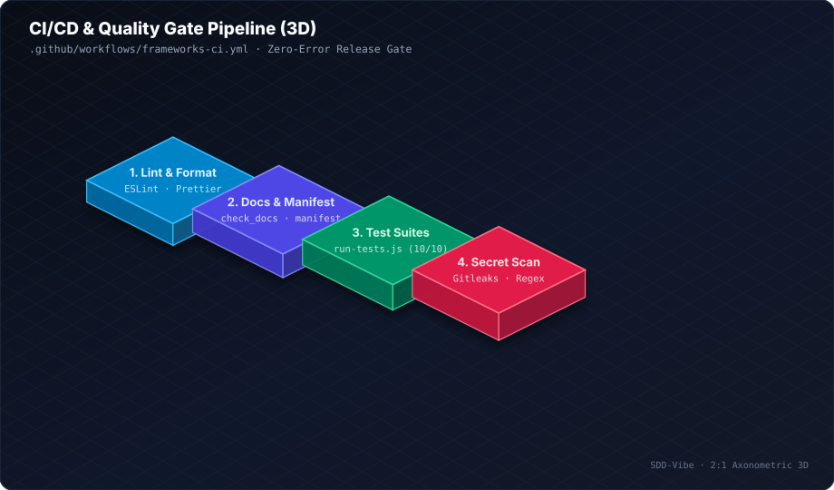

# Skill: performance-profiler

<!-- SDD-VIBE-3D-DIAGRAM -->

**Purpose:** Benchmark application, API, query, and frontend performance against NFR budgets in `docs/performance.md`, reporting strictly measured metrics.

## Trigger

- **MUST** invoke when a task impacts latency-sensitive paths, database queries, bundle size, rendering performance, or NFR performance criteria.

## Inputs

- **MUST** read `AGENTS.md`, `docs/performance.md`, `docs/system-architecture.md`, and relevant `NFR-FEAT###-##` budgets in `docs/features/`.

## Workflow

1. **Baseline & Budget Mapping:**
   - Extract target budgets from `docs/performance.md` (e.g., LCP `< 2.5s`, CLS `< 0.1`, API p95 latency, bundle size ceiling, memory limit).
2. **Frontend & Bundle Profiling:**
   - Measure JS/CSS bundle sizes, render-blocking assets, and Core Web Vitals (LCP, INP/FID, CLS) where applicable.
3. **Backend, Query & Memory Profiling:**
   - Inspect database queries for N+1 patterns, missing indexes, or unbounded `SELECT *` scans.
   - Benchmark API p50/p95/p99 response times and check for unbounded in-memory caches or listener leaks.
4. **Budget Comparison & Remediation:**
   - Compare real measurements against NFR thresholds; flag any budget breach with flamegraph/timing evidence and concrete optimization steps.

## Restrictions

- **MUST NOT** fabricate benchmarks, timings, or load-test numbers; report only observed measurements.
- **MUST NOT** apply premature micro-optimizations that violate clean architecture or readability without a measured bottleneck.
- **MUST NOT** alter NFR budgets without formal change control.