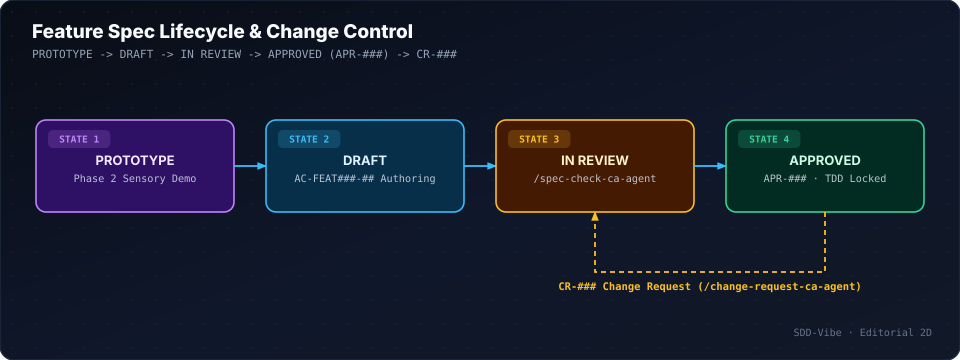

# Feature / Change Request

<!-- SDD-VIBE-3D-DIAGRAM -->

**MUST** capture requester, problem, proposed behavior, excluded behavior, affected spec and impact analysis. **MUST** obtain approval and version the spec before TDD and production code.