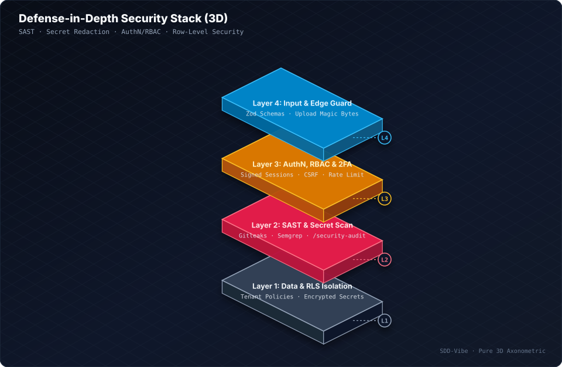

# Security Reporting Policy — Template

<!-- SDD-VIBE-3D-DIAGRAM -->

**MUST** define project-approved confidential reporting contact before public release. **MUST NOT** disclose active vulnerabilities, credentials or user data in public issues. **MUST** state supported versions, triage and coordinated disclosure responsibilities.

Contact: [PROJECT-APPROVED-SECURITY-CHANNEL]