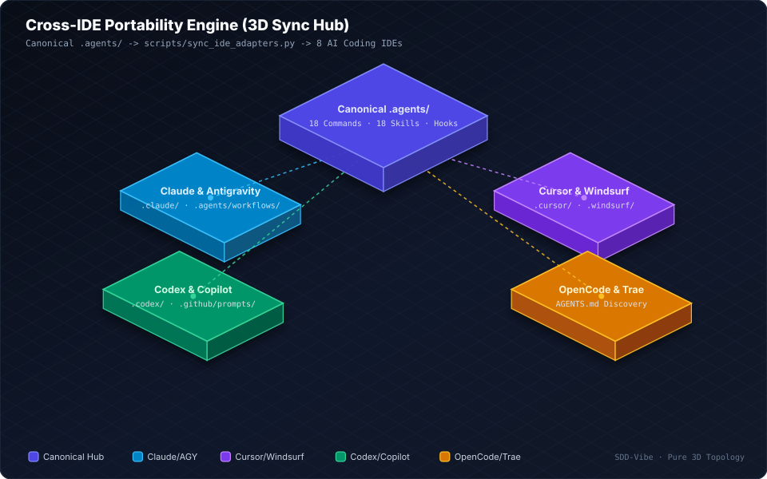

# Claude Code Adapter

<!-- SDD-VIBE-3D-DIAGRAM -->

**MUST** obey `AGENTS.md`, then applicable `docs/` policies and feature specs. **MUST** verify CLI version before creating native skills/hooks/commands under `.claude/`. **MUST** follow the 1-in-2 Hybrid Staged Pipeline: plan & synthesize architecture, verify frontend sensory demo first, lock formal specs, write failing tests before production backend/auth implementation, run checks, and report actual evidence.

Recommended workflow: `activate ca agents` (or `/activate-ca-agent`) after renaming → read `docs/INDEX.md` → inspect task and contract → Phase 1 plan → Phase 2 frontend sensory demo → Phase 3 spec lock & Red-Green-Refactor tests → Phase 4 CI-equivalent checks → report. No native Claude feature is assumed installed.

## Intent & Phase Router (Load On Demand)

Load only the documents, commands, and memory lane needed for the active phase:

| Current Phase / Intent | Read First | Primary Command | Primary Skill | Memory Lane (`docs/memory.md`) |
|---|---|---|---|---|
| **Phase 1: Grilling, Research & Architecture** | `docs/INDEX.md`, `docs/domains/`, `docs/system-architecture.md` | `/plan-ca-agent` | `requirements-analysis` (`grill-me` optional), `task-planner` | Architecture & Domain Lane |
| **Phase 2: Frontend Sensory Demo** | `docs/design.md`, `docs/plan.md`, `docs/skills.md` | `/run-ca-agent` | `ui-fidelity-review`, `accessibility-auditor` | UI/UX & Sensory Demo Lane |
| **Phase 3: Spec Lock & TDD** | `docs/spec.md`, `docs/features/` | `/spec-check-ca-agent`, `/tdd-ca-agent` | `spec-validator`, `tdd-enforcer` | Implementation & TDD Lane |
| **Phase 4: Security, Review & Ship** | `docs/security.md`, `docs/release-checklist.md` | `/security-audit-ca-agent`, `/release-check-ca-agent` | `security-auditor`, `release-validator` | Security, QA & Release Lanes |
| **Ops & Log Triage** | `docs/error-tracker.md`, `logs/` | `/errorlogs-ca-agent` | `debugging-analyst` | Security, QA & Error Triage Lane |

## Transparency & Universal Skill Rule (0-Confusion)

- **Pin-Point Grilling First:** Never draft `docs/prd.md` or `FEAT-###` while any `CRITICAL` ambiguity or `[ASSUMPTION]` remains unresolved.
- **Zero-Confusion Skill Routing:** Consult `docs/skills.md` (§3) and `.agents/skills/agentic-team-ecosystem/references/07-curated-external-skills-registry.md` (§0) across Core, Antigravity, Vercel, Claude, and GitHub skills. Disclose `Skill | Ecosystem | Why Now | Mode` before activating; never silently load Mode 2/3 skills.