# SDD-Vibe Framework (1-in-2 Single Workflow)
### Hybrid Sensory Prototyping + Spec-Driven Development (SDD) & TDD with AI Agents

<div align="center">

[](.)
[](.)
[](.)
[](.)
[](../LICENSE.md)

**Framework Lead:** Chandan Adhikary · **Standard:** Production-Grade Universal Release 2.0.0  
**Target Domains:** SaaS MVPs · Enterprise Core · FinTech · HealthTech · Modern Web Apps · Regulated Systems

[🌟 Framework Overview](#-framework-overview) • [🏛️ Hybrid Pipeline](#️-1-in-2-hybrid-staged-pipeline) • [🔄 Traceability Flow](#-spec-to-code-traceability-contract) • [⚡ Quick-Start](#-quick-start-guide) • [🛡️ Slash Commands](#️-collision-free-agent-slash-commands--ca-agent) • [📁 Structure](#-repository-structure--component-map) • [📋 Governance](#-governance-rules--policies)

</div>

---

## 🌟 Framework Overview

**SDD-Vibe** is a unified **1-in-2 Single Workflow Framework** that combines **Vibe-Coding's** frontend-first sensory prototyping and fluid conversational iteration with **Spec-Driven Development (SDD) + Test-Driven Development (TDD)** contract authority, Red-Green-Refactor discipline, and production quality gates.

### The 4 Pillars of SDD-Vibe:
1. **Architecture & Vibe Discovery First:** Synthesize domain knowledge, HLD/LLD (`docs/system-architecture.md`), aesthetic tokens (`docs/design.md`), and living prompts (`docs/plan.md`, `docs/prompts.md`) before generating code.
2. **Frontend-First Sensory Demo:** Build the frontend UI first with `PROTOTYPE` → `DRAFT` living specs, verify interactively via `/run-ca-agent` (`http://localhost:3000`), and tune the experience conversationally until approved.
3. **Formal Spec Lock & Red-Green-Refactor TDD:** Lock feature specs (`IN REVIEW` → `APPROVED` in `docs/spec.md` & `docs/approvals/`), write failing tests against `AC-FEAT###-##` (`RED`), implement minimal backend/persistence/auth/logic (`GREEN`), and refactor cleanly.
4. **Mandatory Development Logging (`logs/` Folder):** Always record clean, sanitized development logs (`logs/dev.log`, `logs/test.log`, `logs/server.log`, `logs/error.log`) inside a dedicated `logs/` directory.

---

## 🏛️ 1-in-2 Hybrid Staged Pipeline

```mermaid
flowchart TB
    classDef gov fill:#0f172a,stroke:#38bdf8,stroke-width:1.5px,color:#f8fafc;
    classDef vibe fill:#2e1065,stroke:#c084fc,stroke-width:1.5px,color:#faf5ff;
    classDef red fill:#4c0519,stroke:#fb7185,stroke-width:2px,color:#fff1f2;
    classDef green fill:#064e3b,stroke:#34d399,stroke-width:2px,color:#ecfdf5;
    classDef gate fill:#451a03,stroke:#fbbf24,stroke-width:2px,color:#fffbeb;

    subgraph Row1 ["🎨 DISCOVERY & FRONTEND SENSORY TIERS"]
        direction LR
        subgraph Phase1 ["🏛️ 1. ARCHITECTURE & VIBE DISCOVERY"]
            ProductVision["<b>💡 Product & Plan</b><br/><small>CAP-### • docs/plan.md</small>"]:::gov
            SysArch["<b>🏛️ System Architecture</b><br/><small>HLD/LLD • docs/design.md</small>"]:::gov
            HumanP1{"Design Approved?"}:::gate
        end

        subgraph Phase2 ["🎨 2. FRONTEND SENSORY DEMO"]
            ProtoUI["<b>💻 Scaffold UI Shell</b><br/><small>PROTOTYPE → DRAFT • Mock State</small>"]:::vibe
            LiveDemo["<b>🌐 Run /run-ca-agent</b><br/><small>Inspect at :3000 • Tune Vibe</small>"]:::vibe
            VibeGate{"Sensory UI Approved?"}:::gate
        end
    end

    subgraph Row2 ["🧪 FORMAL SPEC LOCK, TDD & RELEASE TIERS"]
        direction LR
        subgraph Phase3 ["🔒 3. SPEC LOCK & TDD CYCLE"]
            LockSpec["<b>📋 Lock Feature Spec</b><br/><small>IN REVIEW → APPROVED</small>"]:::gov
            RedTest["<b>🔴 RED: Failing Tests</b><br/><small>/testing-ca-agent</small>"]:::red
            GreenCode["<b>🟢 GREEN: Backend & Auth</b><br/><small>/tdd-ca-agent • /implement</small>"]:::green
        end

        subgraph Phase4 ["🚀 4. QUALITY AUDIT & SHIP"]
            CodeReview["<b>🔍 Review & Verify</b><br/><small>/review & /verify Scorecard</small>"]:::gov
            SecurityScan["<b>🛡️ Security Audit</b><br/><small>/security-audit-ca-agent</small>"]:::gov
            ReleaseGate{"Release Gate Passed?"}:::gate
            ProductionDeploy(["<b>🎉 Production Ship</b><br/><small>/release-check-ca-agent</small>"]):::green
        end
    end

    ProductVision -->|"Architects"| SysArch
    SysArch -->|"Submits"| HumanP1
    HumanP1 -->|"Revise"| ProductVision
    HumanP1 -->|"Approved"| ProtoUI

    ProtoUI -->|"Launch"| LiveDemo
    LiveDemo -->|"Tune"| VibeGate
    VibeGate -->|"Iterate UI"| ProtoUI
    VibeGate ==>|"UI Signed Off"| LockSpec

    LockSpec -->|"Contract"| RedTest
    RedTest -->|"Minimal Code"| GreenCode
    GreenCode -->|"Verify"| CodeReview

    CodeReview -->|"Pass"| SecurityScan
    SecurityScan -->|"Clean"| ReleaseGate
    ReleaseGate -->|"Authorized"| ProductionDeploy
```



---

## 🔄 Spec-to-Code Traceability Contract

Every line of production code traces back to a root business capability:


---

## ⚡ Quick-Start Guide

### Step 1: Scaffolding into Your Project Workspace
Extract or copy the `SDD-Vibe-Framework/` directory into your project root:
```bash
# Rename to your target project name (kebab-case)
mv SDD-Vibe-Framework my-production-app
cd my-production-app
```

### Step 2: Verify Slash Commands
Verify that your host IDE recognizes the `.agents/` contracts:
1. Focus your AI agent chat and type `/`. Confirm all 17 `*-ca-agent` commands appear with descriptions.
2. In terminal, verify command contracts:
   ```bash
   ls .agents/commands/*-ca-agent.md
   ```

### Step 3: Launch In-IDE Project-Manager-Dashboard
Launch the dedicated telemetry dashboard on port `4200`:
- **Slash Command:** Type `/dashboard-ca-agent` in agent chat.
- **Terminal:** Run `Project-Manager-Dashboard/open-in-ide.bat` (Windows) or `bash Project-Manager-Dashboard/open-in-ide.sh` (macOS/Linux).
- **Dock in IDE:** Open `Simple Browser: Show`, navigate to `http://127.0.0.1:4200`, and dock in Editor Group 2.

---

## 🛡️ Collision-Free Agent Slash Commands (`-ca-agent`)

All custom commands carry the `-ca-agent` namespace to guarantee zero collisions with IDE-reserved tokens:

| Command | Category | Operational Purpose |
| :--- | :--- | :--- |
| `/plan-ca-agent` | Planning | Scoped, read-only system design and architectural alignment. |
| `/task-ca-agent` | Planning | Atomic task harness initialization and contract tracking. |
| `/spec-check-ca-agent` | Specs | Validates feature spec compliance against acceptance criteria. |
| `/change-request-ca-agent` | Specs | Formal change request, impact assessment, and spec revision. |
| `/testing-ca-agent` | Execution | Targeted test execution; confirms failing tests in Red phase. |
| `/tdd-ca-agent` | Execution | Red-Green-Refactor implementation satisfying acceptance criteria. |
| `/implement-ca-agent` | Execution | Scope-restricted feature implementation. |
| `/run-ca-agent` | Execution | Local runtime verification (Phase 2 sensory demo & backend runtime). |
| `/review-ca-agent` | Quality | Pre-commit diff, lint, and security review. |
| `/verify-ca-agent` | Quality | Objective scorecard validation against specification contracts. |
| `/security-audit-ca-agent` | Security | SAST, secret leak, and dependency audit across codebase. |
| `/release-check-ca-agent` | Release | Production readiness gate and ship/no-ship decision. |
| `/dashboard-ca-agent` | Dashboard | Launches local In-IDE Project-Manager-Dashboard on port 4200. |
| `/errorlogs-ca-agent` | Diagnostics | Structured runtime error triage and stack trace analysis. |
| `/gitlogs-ca-agent` | Diagnostics | Commit history and git traceability validation against task IDs. |
| `/handoff-ca-agent` | Handoff | Generates verifiable engineering handoff report for team transfer. |
| `/team-ecosystem-ca-agent` | Orchestration | Activates the optional 14-team `agentic-team-ecosystem` skill step by step. |

---

## 📁 Repository Structure & Component Map

```mermaid
flowchart LR
    classDef agent fill:#0f172a,stroke:#38bdf8,stroke-width:2px,color:#f8fafc;
    classDef doc fill:#1e293b,stroke:#818cf8,stroke-width:1.5px,color:#f8fafc;
    classDef dash fill:#082f49,stroke:#0284c7,stroke-width:2px,color:#f0f9ff;
    classDef test fill:#064e3b,stroke:#34d399,stroke-width:1.5px,color:#ecfdf5;
    classDef log fill:#2e1065,stroke:#c084fc,stroke-width:1.5px,color:#faf5ff;

    subgraph RepoRoot ["🧭 SDD-VIBE-FRAMEWORK /"]
        AGENTS["<b>🤖 Agent Master Directives</b><br/><small>AGENTS.md • GEMINI.md • CLAUDE.md</small>"]:::agent
        AgentsDir["<b>🛠️ .agents/ Canonical Asset Store</b><br/><small>17 Commands • 19 Skills • Lifecycle Hooks</small>"]:::agent
        DocsDir["<b>📑 docs/ Architecture & Living Specs</b><br/><small>Plan • Prompts • Spec • ADRs • Approvals</small>"]:::doc
        DashboardDir["<b>🖥️ Project-Manager-Dashboard</b><br/><small>In-IDE Mission Control • Local Port 4200</small>"]:::dash
        TestsDir["<b>🧪 tests/ Automated Test Harness</b><br/><small>Unit, Integration & E2E Acceptance Suites</small>"]:::test
        LogsDir["<b>🪵 logs/ Audit Directory</b><br/><small>Structured Runtime Logs • Sanitized PII</small>"]:::log
    end
```



---

## 📋 Governance Rules & Policies

- **Guideline Baseline:** Fixed baseline `2.0.0`; modifications require explicit justification and logging in `docs/guideline-CHANGELOG.md`.
- **Feature Lifecycle:** `PROTOTYPE` (Frontend Sensory Demo) → `DRAFT` → `IN REVIEW` → `APPROVED` (Formal Lock for Backend/Auth/Persistence) → `SUPERSEDED` / `DEPRECATED`.
- **Dual Format Policy:**
  - **Flat Format (`docs/features/NNN-name.md`):** Tier 1 (Easy) and Tier 2 (Intermediate) features.
  - **Modular Format (`docs/features/NNN-name/{feature,acceptance,test-plan}.md`):** Tier 3 (Complex / Distributed) features.
- **Traceability Requirement:** All tests must carry `TEST-FEAT###-## / AC-FEAT###-##: <behavior>` in their title.
- **Development Logging:** All command runs and background test suites must write sanitized output to `logs/*.log`.
