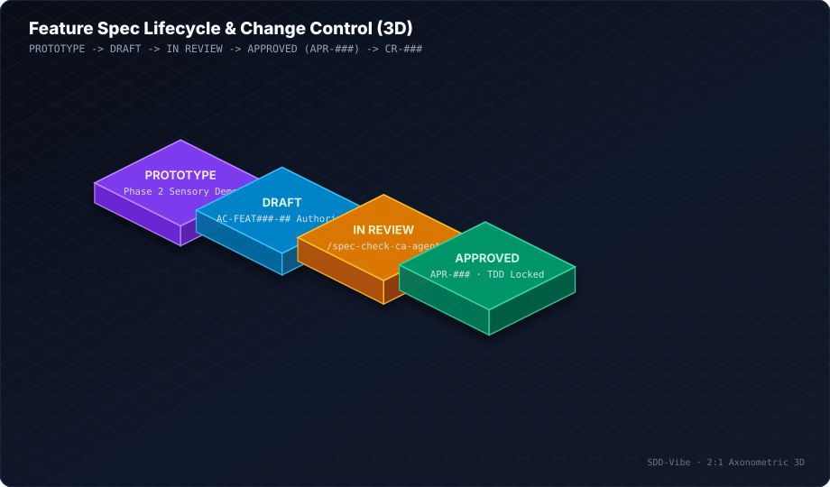
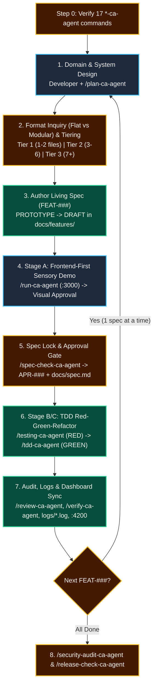

# Granular Feature Development Workflow (Agent & Developer)

> **Document class:** Controlled process guideline  
> **Framework:** SDD-Vibe  
> **Guideline baseline:** 1.0.0  
> **Status:** Approved

<!-- SDD-VIBE-3D-DIAGRAM -->

## Purpose

Define the granular, step-by-step collaboration protocol between the **Developer** and **AI Agents** when planning, specifying, prototyping, testing, implementing, and shipping individual features (`FEAT-###`) in `SDD-Vibe`.

## Agent read trigger

**MUST** read or consult this file: Before initiating a new feature specification (`FEAT-###`), breaking down tasks, or coordinating multi-step feature development between the developer and agents.

## End-to-End Granular Loop

## Developer vs. Agent Granular Collaboration Matrix

Every feature moves strictly **one `FEAT-###` at a time** through the following stages:

| Stage | Developer Action | Agent Action | Commands & Canonical Artifacts |
|---|---|---|---|
| **0. Activation Gate** | Type `/` in IDE chat to verify all 17 `*-ca-agent` slash commands are loaded. | Verify `.agents/commands/*-ca-agent.md` exist before creating or editing any code. | `/plan-ca-agent`, `/team-ecosystem-ca-agent` |
| **1. Pre-Planning & System Design** | Provide domain rules, business constraints, and user goals (or ask the agent to formulate HLD/LLD). | Execute the 5-step cyclic loop; inspect `docs/system-architecture.md`, `docs/prd.md`, and `docs/design.md`. | `/plan-ca-agent`, `docs/system-architecture.md` |
| **2. Format Inquiry & Tiering** | Choose **Flat** (`docs/features/NNN-name.md`) or **Modular** (`docs/features/NNN-name/{feature,acceptance,test-plan}.md`). | **MUST** ask format preference first; auto-classify Tier 1 (1–2 files), Tier 2 (3–6 files), or Tier 3 (7+ files) if unspecified. | `docs/features/FEATURE-TEMPLATE.md`, `playbooks/03-Features-Development.txt` |
| **3. Living Spec Authoring** | Review drafted requirements (`FR-*`, `NFR-*`) and Given/When/Then acceptance criteria (`AC-FEAT###-##`). | Scaffold `FEAT-###` in `PROTOTYPE` or `DRAFT`, map `CAP-###` → `REQ-###` → `FEAT-###` → `TEST-*`, and update `docs/task.md`. | `docs/features/README.md`, `docs/requirements-traceability.md` |
| **4. Frontend-First Sensory Demo** | Interact with live UI on `:3000` and provide conversational vibe-tuning feedback until satisfied. | Build frontend UI and mock/client state first; never implement backend persistence before visual approval. | `/run-ca-agent`, `docs/plan.md`, `docs/prompts.md` |
| **5. Spec Lock & Approval** | Record human sign-off in `docs/approvals/APR-###.md` (or request `CR-###` for post-approval edits). | Run `/spec-check-ca-agent`, transition spec to `APPROVED`, and index it in `docs/spec.md`. | `/spec-check-ca-agent`, `/change-request-ca-agent`, `docs/approvals/` |
| **6. TDD Red-Green-Refactor** | Confirm task scope and review diffs/test evidence. | **RED:** `/testing-ca-agent` writes failing tests per `AC-FEAT###-##`. **GREEN:** `/tdd-ca-agent` & `/implement-ca-agent` write minimal code. **REFACTOR:** clean code while keeping tests 100% green. | `/task-ca-agent`, `/testing-ca-agent`, `/tdd-ca-agent`, `/implement-ca-agent` |
| **7. Verification, Logs & Dashboard** | Monitor progress on the In-IDE Project-Manager-Dashboard (`:4200`). | Maintain sanitized logs in `logs/*.log`; run `/review-ca-agent`, `/verify-ca-agent`, `check_docs.py`, and `manifest.py --check`. Update `docs/task.md` & `docs/error-tracker.md`. | `/dashboard-ca-agent`, `/review-ca-agent`, `/verify-ca-agent`, `/errorlogs-ca-agent` |
| **8. Security, Release & Handoff** | Issue final human go/no-go ship decision. | Run `/security-audit-ca-agent`, `/release-check-ca-agent`, and `/handoff-ca-agent`; append Memory Delta to `docs/memory.md`. | `/security-audit-ca-agent`, `/release-check-ca-agent`, `/handoff-ca-agent` |

## Single-Agent vs. Multi-Agent Execution

- **Single-Agent Sequential Mode:** Ideal for Tier 1 and Tier 2 features. The primary agent executes `/plan-ca-agent` → `/tdd-ca-agent` → `/implement-ca-agent` → `/verify-ca-agent` on one `FEAT-###` at a time.
- **Multi-Agent Orchestration Mode:** Ideal for Tier 3 features. Invoke `/team-ecosystem-ca-agent` and follow `docs/agents.md`: pass exact `FEAT-###` version, task ID, and allowed files via `.agents/templates/AGENT-TASK-CONTRACT.md`, isolate parallel edits, require `.agents/templates/AGENT-COMPLETION-REPORT.md`, and emit a Memory Delta to `docs/memory.md`.
- **Just-In-Time (JIT) Opt-In Team Activation Rule:** Never trigger all 14 ecosystem teams at once. Start with **Main Agent + Team 14** only, keep Teams 1–13 dormant, and activate a specific team **only** when the Developer explicitly requests it or confirms a **Team Activation Notice** at that team's exact step (see `.agents/skills/agentic-team-ecosystem/references/01-hierarchy-and-auto-triggers.md`).

## Evidence and change control

- **MUST** record owner, revision/date, relevant approval reference, and traceable evidence in the applicable project instantiation.
- **MUST** route changes to process rules through `docs/guideline-CHANGELOG.md` and formal baseline revision; route feature behavior through approved versioned specs and `docs/CHANGELOG.md`.
- **SHOULD** keep links to canonical artifacts instead of duplicating definitions.

## SDD-Vibe enforcement

- **MUST** complete Step 0 command verification before creating or editing application code.
- **MUST NOT** start a subsequent `FEAT-###` until the current feature's `AC-FEAT###-##` criteria pass all automated tests and living trackers (`docs/task.md`, `docs/spec.md`, `logs/*.log`) are updated.