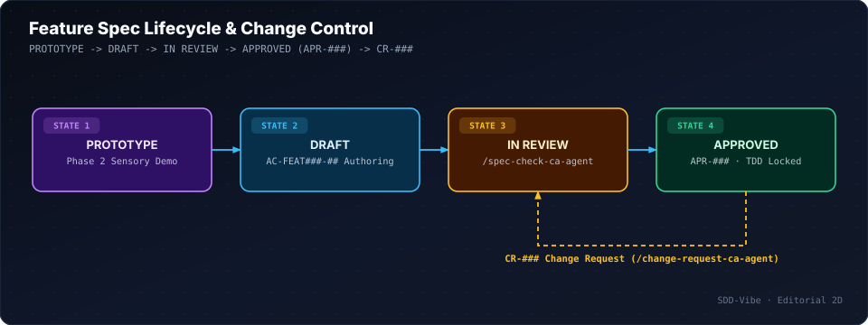

# AI-Powered Project Development — 1-in-2 Single Workflow (`SDD-Vibe`) Reference Guide: EduSphere SMS

<!-- SDD-VIBE-3D-DIAGRAM -->

**Framework:** SDD-Vibe (1-in-2 Single Workflow)  
**Author:** Chandan Adhikary  
**Reference Application:** EduSphere Multi-Tenant School Management System (SMS)  
**Stack:** Next.js App Router + Tailwind + Shadcn UI · TypeScript · PostgreSQL (RLS) · Vitest + Playwright  
**Compliance:** FERPA Student Data Privacy · Role-Based Access Control (Admin, Teacher, Student, Parent)  

---

## 1. Domain & System Architecture Synthesis (Phase 1)

Before writing code, EduSphere establishes its domain taxonomy (`CAP-###` → `REQ-###`) and multi-tenant architecture:
- **Tenancy Model:** `school_id` isolation enforced at the PostgreSQL Row-Level Security (RLS) layer.
- **Core Capabilities:**
  - `CAP-001`: Student Lifecycle & Enrollment (`FEAT-002`)
  - `CAP-002`: Attendance, Grading & Report Cards
  - `CAP-003`: Parent Portal & Fee Ledger
- **Governance Artifacts:** `docs/product.md`, `docs/prd.md`, `docs/system-architecture.md`, `docs/design.md`, `docs/plan.md`, `docs/prompts.md`.

---

## 2. Frontend-First Sensory Demo (Phase 2)

1. Author `docs/features/002-student-enrollment.md` starting in `PROTOTYPE` → `DRAFT` status.
2. Scaffold the **EduSphere Enrollment & Roster UI** with Shadcn UI Zinc/Slate tokens, responsive sidebar, and mock student roster state.
3. Launch `/run-ca-agent` (`http://localhost:3000`) and verify:
   - Enrollment form validation UX, table filtering, and mobile responsiveness.
   - Interactive role switcher (Admin vs. Teacher view) in mock state.
4. Obtain visual sign-off before touching PostgreSQL or authentication endpoints.

---

## 3. Formal Spec Lock & TDD Backend Hardening (Phase 3)

1. **Spec Lock:** Promote `FEAT-002` to `APPROVED` in `docs/spec.md` with sign-off in `docs/approvals/APR-002.md`. Run `/spec-check-ca-agent`.
2. **RED Phase (`/testing-ca-agent`):** Write failing tests in `tests/` mapped to `AC-FEAT002-01` (unique student ID per `school_id`), `AC-FEAT002-02` (FERPA role guard), and `AC-FEAT002-03` (enrollment persistence). Confirm failures in `logs/test.log`.
3. **GREEN Phase (`/tdd-ca-agent`):** Implement PostgreSQL RLS policies, Zod DTO validation, and enrollment API handlers until all tests pass.
4. **Refactor:** Extract shared tenant-context middleware and re-verify 100% green tests.

---

## 4. Quality Audit & Production Release (Phase 4)

- Run `/review-ca-agent` and `/verify-ca-agent` to confirm `AC-*` → `TEST-*` traceability.
- Run `/security-audit-ca-agent` (with `gitleaks`, `semgrep`, and `trivy`) to verify zero secret leaks and strict `school_id` RLS enforcement.
- Run `python scripts/check_docs.py` and `python scripts/manifest.py --check`.
- Execute `/release-check-ca-agent` for final production sign-off.

---

## 5. Recommended GitHub & Official Skills / Plugins for EduSphere SMS

All external skills are **optional (Developer Choice)** and vetted per [`07-curated-external-skills-registry.md`](SDD-Vibe-Framework/.agents/skills/agentic-team-ecosystem/references/07-curated-external-skills-registry.md):
- **Core Baseline:** [`anthropics/skills`](https://github.com/anthropics/skills), `claude-mem`, `serena`
- **Discovery & Visual Plan Review:** `grill-me`, [`backnotprop/plannotator`](https://github.com/backnotprop/plannotator), [`cathrynlavery/diagram-design`](https://github.com/cathrynlavery/diagram-design)
- **Next.js / React UI Demo:** [`vercel-labs/agent-skills`](https://github.com/vercel-labs/agent-skills), [`juxtopposed/realtimecolors`](https://github.com/juxtopposed/realtimecolors), [`ibelick/motion-primitives`](https://github.com/ibelick/motion-primitives)
- **E2E & Security Gates:** [`microsoft/playwright`](https://github.com/microsoft/playwright), [`gitleaks/gitleaks`](https://github.com/gitleaks/gitleaks), [`semgrep/semgrep`](https://github.com/semgrep/semgrep), [`aquasecurity/trivy`](https://github.com/aquasecurity/trivy)