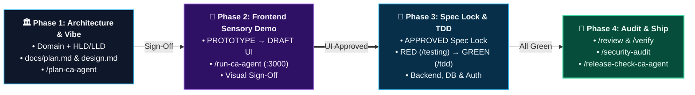

# AI-Powered Project Development — Universal 1-in-2 Single Workflow (`SDD-Vibe`) Production Guide for Any Project

**Framework:** SDD-Vibe (1-in-2 Single Workflow: Vibe-Coding Sensory Discovery + SDD-TDD Contract Assurance)  
**Author:** Chandan Adhikary  
**Application Scope:** Universal (SaaS Platforms, Consumer Web Apps, B2B Dashboards, Marketplaces, Enterprise Core, FinTech, HealthTech, AI Interfaces)  
**Reference Example:** EduSphere Multi-Tenant School Management System (SMS)  
**Target IDEs:** Claude Code, Cursor, Windsurf, Antigravity, GitHub Copilot, Codex, Trae, VS Code with AI Agents  

---

## 1. Executive Summary & Guiding Philosophy

**SDD-Vibe (1-in-2 Single Workflow)** unifies **Vibe-Coding's** rapid frontend-first sensory prototyping with **Spec-Driven Development (SDD) + Test-Driven Development (TDD)** contract-first engineering. Instead of choosing between speed and rigor, every project moves through one cohesive **4-Phase Hybrid Staged Pipeline**:

1. **Phase 1 — Architecture & Vibe Discovery:** Synthesize domain knowledge, HLD/LLD (`docs/system-architecture.md`), aesthetic tokens (`docs/design.md`), and living prompts (`docs/plan.md`, `docs/prompts.md`).
2. **Phase 2 — Frontend-First Sensory Demo & Living Spec:** Build the frontend UI first (`PROTOTYPE` → `DRAFT` specs in `docs/features/`), launch a live demo (`/run-ca-agent` at `:3000`), and iterate conversationally until design and UX are visually signed off.
3. **Phase 3 — Formal Spec Lock & TDD Red-Green-Refactor:** Lock feature contracts (`IN REVIEW` → `APPROVED` in `docs/spec.md` & `docs/approvals/`), write failing tests (`RED` via `/testing-ca-agent`), implement minimal backend/persistence/auth/logic (`GREEN` via `/tdd-ca-agent` and `/implement-ca-agent`), and refactor cleanly.
4. **Phase 4 — Quality Audit & Production Ship:** Execute `/review-ca-agent`, `/verify-ca-agent`, `/security-audit-ca-agent`, and `/release-check-ca-agent` before release.

### Non-Negotiable Directives
- **Never Code Speculatively:** Inspect `AGENTS.md`, `docs/INDEX.md`, and `docs/constitution.md` before writing code.
- **Pre-Prompting Domain & System Design Synthesis:** Establish domain vocabulary, compliance rules, and HLD/LLD before Prompt 1.
- **Mandatory Development Logging (`logs/`):** Write all sanitized dev, test, server, and error logs to `logs/dev.log`, `logs/test.log`, `logs/server.log`, and `logs/error.log`.
- **Single-Feature Pacing & Dual Spec Format:** Build one `FEAT-###` at a time using Flat (`docs/features/NNN-name.md`) for Tier 1–2 or Modular (`docs/features/NNN-name/{feature,acceptance,test-plan}.md`) for Tier 3.

---

## 2. Universal Variable Substitution Matrix

Replace these placeholders when adapting this guide to any project:

| Placeholder | Meaning | Example (EduSphere SMS) |
|---|---|---|
| `{{PROJECT_NAME}}` | Lowercase kebab-case workspace name | `edusphere-sms` |
| `{{DOMAIN}}` | Industry & regulatory domain | `K-12 Multi-Tenant EdTech (FERPA)` |
| `{{FRONTEND_STACK}}` | UI framework & styling tokens | `Next.js App Router + Tailwind + Shadcn UI` |
| `{{BACKEND_STACK}}` | API, ORM & database engine | `TypeScript API + Prisma + PostgreSQL RLS` |
| `{{AUTH_MODEL}}` | Authentication & authorization model | `JWT + RBAC (Admin, Teacher, Student, Parent)` |
| `{{TEST_RUNNER}}` | Unit, integration & E2E runner | `Vitest + Playwright` |

---

## 3. Step-by-Step 1-in-2 Production Execution Playbook

### Step 0: Blueprint Setup & Command Verification
1. Copy `SDD-Vibe-Framework/` to `{{PROJECT_NAME}}/` and open it at the workspace root.
2. Verify all 17 `*-ca-agent` commands appear in the IDE chat `/` dropdown and via `ls .agents/commands/*-ca-agent.md` (including optional `/team-ecosystem-ca-agent` for 14-team orchestration).
3. Launch the In-IDE Project-Manager-Dashboard (`/dashboard-ca-agent` at `http://127.0.0.1:4200`).

### Phase 1: Architecture & Vibe Discovery (`/plan-ca-agent`, `/task-ca-agent`)
- Synthesize domain knowledge, `docs/product.md` (`CAP-###`), `docs/prd.md` (`REQ-###`), `docs/system-architecture.md` (HLD/LLD), `docs/design.md` (aesthetic tokens), `docs/plan.md`, and `docs/prompts.md`.
- Initialize `docs/task.md` and `docs/phases.md`. Obtain human sign-off on architecture and visual direction.

### Phase 2: Frontend-First Sensory Demo (`/implement-ca-agent`, `/run-ca-agent`)
- Create a `PROTOTYPE` → `DRAFT` feature spec in `docs/features/001-<feature>.md`.
- Scaffold the interactive frontend UI with realistic mock/client state (no production DB/auth yet).
- Run `/run-ca-agent` (`http://localhost:3000`) and iterate conversationally until layout, responsiveness, and UX are approved.

### Phase 3: Formal Spec Lock & Red-Green-Refactor TDD (`/spec-check-ca-agent`, `/testing-ca-agent`, `/tdd-ca-agent`)
- Promote the feature spec to `IN REVIEW` → `APPROVED` (indexed in `docs/spec.md`, approval record in `docs/approvals/`).
- Run `/spec-check-ca-agent` to verify `AC-FEAT###-##` Given/When/Then scenarios and `TEST-FEAT###-##` mappings.
- **RED:** Run `/testing-ca-agent` to write and confirm failing tests against each `AC-*`.
- **GREEN & REFACTOR:** Run `/tdd-ca-agent` to implement minimal backend APIs, database schemas, RLS/auth guards, and input validation until all tests pass, then refactor cleanly.

### Phase 4: Quality Audit & Production Ship (`/review-ca-agent`, `/verify-ca-agent`, `/security-audit-ca-agent`, `/release-check-ca-agent`)
- Run `python scripts/check_docs.py` and `python scripts/manifest.py --check` (0 errors required).
- Execute `/review-ca-agent`, `/verify-ca-agent`, `/security-audit-ca-agent`, and `/release-check-ca-agent` to sign off the release.

---

## 4. First-Choice Agentic Skill Development & Custom Feature Lifecycle

> **First Choice:** Whole features are developed through `agentic-team-ecosystem` (`/team-ecosystem-ca-agent`). SDD-Vibe slash commands and external skills trigger at exact step gates so nothing runs speculatively.

### Preset Multi-IDE Chat Tabs (Claude Code, Antigravity, Cursor, Windsurf, Codex, Copilot)
1. Run `python scripts/sync_ide_adapters.py --ides all` inside `{{PROJECT_NAME}}/`.
2. Every host IDE chat tab now has all `17` `/-ca-agent` commands and `19` skills preset (`.claude/`, `.agents/workflows/`, `.cursor/`, `.windsurf/`, `.codex/`, `.github/prompts/`).
3. Use dedicated chat tabs per Group/Step (e.g., Tab 1: `/team-ecosystem-ca-agent` + `/plan-ca-agent`, Tab 2: `/run-ca-agent`, Tab 3: `/tdd-ca-agent`, Tab 4: `/dashboard-ca-agent`) to keep context windows lean.

### External Skill Mapping & Exact Trigger Timing (Max 1–3/Step, Rank #1 Only)
All external skills require the **5-Point Security Vetting Checklist** ([`07-curated-external-skills-registry.md`](SDD-Vibe-Framework/.agents/skills/agentic-team-ecosystem/references/07-curated-external-skills-registry.md)) before installation:
- **Core (Always-On):** `anthropics/skills`, `claude-mem`, `serena`, `playwright`, `gitleaks`.
- **Step 1 (Discovery):** `grill-me` (Team 2 + Team 14 requirement grilling) → triggers `/plan-ca-agent`.
- **Step 2 (Architecture):** `find-skill` (Team 2 verified skill lookup) → triggers `/task-ca-agent`.
- **Step 3 (UI Sensory Demo):** `vercel-labs` / `modern-web-guidance` (+ `recharts`, `motion-dev`, `react-spline` only if domain requires) → triggers `/implement-ca-agent` + `/run-ca-agent`.
- **Step 4 (Kanban Sync):** Team 1 exports Google Sheet CSV via `/dashboard-ca-agent` (`#ecosystem` + `/api/kanban-export`).
- **Step 5 (Spec Lock & TDD):** `dify` / `openhands` / `REA` (if AI/LLM or reverse-engineering) → triggers `/spec-check-ca-agent` → `/testing-ca-agent` (`RED`) → `/tdd-ca-agent` (`GREEN/REFACTOR`).
- **Step 6 (Security & QA Gate):** `semgrep`, `trivy`, `trufflehog` (Team 6) → triggers `/review-ca-agent` → `/verify-ca-agent` → `/security-audit-ca-agent`.
- **Step 7–9 (Docs, Marketing, Deploy & 24×7 Ops):** `ppt-master` (Team 11), `claude-seo` & `postiz-app` (Team 13) → triggers `/handoff-ca-agent`, `/release-check-ca-agent`, `/errorlogs-ca-agent`, `/gitlogs-ca-agent`.

### Adding New Custom Features Later or Mid-Development
1. If modifying an already-`APPROVED` spec, run `/change-request-ca-agent` (`CR-###`) first.
2. Invoke `/team-ecosystem-ca-agent <domain-or-feature>` so **Team 14** classifies the new custom feature and guides you step by step.
3. Execute the full SDD-Vibe loop for the new feature: `/plan-ca-agent` → `/task-ca-agent` → `docs/features/NNN-name.md` (`PROTOTYPE`) → `/implement-ca-agent` + `/run-ca-agent` → `/dashboard-ca-agent` (Kanban sync) → `/spec-check-ca-agent` (`APPROVED`) → `/testing-ca-agent` → `/tdd-ca-agent` → `/review-ca-agent` → `/verify-ca-agent` → `/security-audit-ca-agent`.
