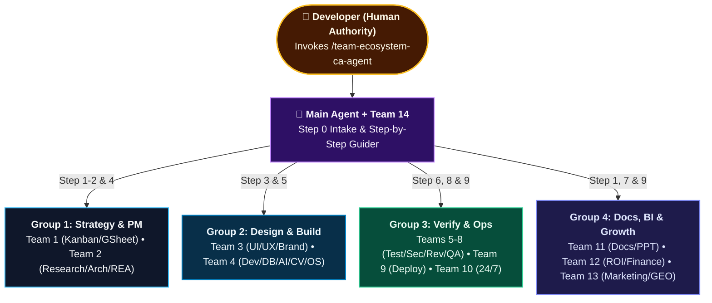

# SDD-Vibe Detailed "When & What to Use" Team-Based Guide
### Complete Operational Playbook for the 4-Group / 14-Team `agentic-team-ecosystem`

[_Opt--In-indigo?style=for-the-badge)](.)

**Engineering Lead:** Chandan Adhikary · **Release:** SDD-Vibe 2.0.0 Universal

---

## 1. How the 14-Team Ecosystem Works (Zero Token Bloat)

When you activate **`/team-ecosystem-ca-agent`**, **all 14 teams do NOT run at once**.
- At **Step 0**, only the **Main Agent (Orchestrator)** and **Team 14 (Manual Workflow Guider)** wake up.
- **Teams 1–13 stay DORMANT** (using zero context tokens) until either:
  1. You **explicitly ask** for a team (e.g., *"activate Team 6 security audit"*), **OR**
  2. You reach the exact step gate where that team is needed, and you reply **"yes / activate Team N"** to the **Team Activation Notice**.

---

## 2. Master "When & What to Use" Table (All 14 Teams)

| Team | Group | Exact **WHEN** to Use (Step & Gate) | Exact **WHAT** It Does & Produces | SDD-Vibe Command(s) | Model Tier & Key Skills |
| :--- | :--- | :--- | :--- | :--- | :--- |
| **Team 1** *(PM / Kanban)* | Group 1 | **Step 4:** Immediately after Step 3 Frontend UI Demo is approved | Initializes Kanban board, updates `docs/task.md`, exports **Google Sheet CSV** (`/api/kanban-export`) | `/task-ca-agent`, `/dashboard-ca-agent` (`#ecosystem`) | **🟢 Lite/Fast** · `task-planner` |
| **Team 2** *(Research / Arch / REA)* | Group 1 | **Steps 1–2:** Discovery, grilling, architecture, or reverse-engineering legacy code | Grills requirements, creates HLD/LLD, DFD/UML, ER diagrams, `docs/plan.md`, `docs/system-architecture.md`, model evals | `/plan-ca-agent` | **🔥 Full-Potential Pro** · `requirements-analysis`, `architecture-review`, `grill-me`, `plannotator`, `diagram-design`, `REA` |
| **Team 3** *(UI / UX / Brand Design)* | Group 2 | **Step 3:** Frontend / Interface Design & Sensory Demo *(skip for headless/OS unless dashboard UI needed)* | Creates visual tokens (`docs/design.md`), responsive UI mockups, copy, & interactive `:3000` UI prototype | `/implement-ca-agent` (UI), `/run-ca-agent` | **⚡ Standard** · `ui-fidelity-review`, `vercel-labs/agent-skills`, `Realtime-color`, `motion-primitives`, `Haikei` |
| **Team 4** *(Core Dev / AI / CV / OS)* | Group 2 | **Step 3 (UI only)** & **Step 5:** After `FEAT-###` is `APPROVED` + `APR-###` locked | Implements backend APIs, DB/RLS, auth, AI/RAG/ML/CV, or OS/HAL code under Red-Green-Refactor TDD + `logs/` | `/spec-check-ca-agent`, `/tdd-ca-agent`, `/implement-ca-agent` | **🔥 Pro (Logic/DB)** / **⚡ Standard** · `tdd-enforcer`, `database-migration-review`, `dify`/`openhands` |
| **Team 5** *(Testing)* | Group 3 | **Step 6 (Gate 1):** After Step 5 unit tests pass | Runs unit, integration, API contract, alpha/beta, white/black/grey-box, & E2E browser suites (`logs/test.log`) | `/testing-ca-agent` | **🟢 Lite/Fast** · `playwright` (`microsoft/playwright`) |
| **Team 6** *(Security Testing)* | Group 3 | **Step 6 (Gate 2):** After Team 5 passes *(mandatory for auth, PII/HIPAA/FERPA, web, OS)* | Runs 27-point security audit, SAST, secret scanning, CVE check, RBAC/2FA/upload checks | `/security-audit-ca-agent` | **🔥 Full-Potential Pro** · `security-auditor`, `gitleaks`, `semgrep`, `trivy`, `trufflehog` |
| **Team 7** *(Code Review)* | Group 3 | **Step 6 (Gate 3):** After Team 6 security scan is clean | Audits `git diff`, scope adherence, code quality, and `AC-*` → `TEST-*` traceability | `/review-ca-agent` | **⚡ Standard / Pro** · `code-reviewer`, `api-contract-review`, `plannotator` |
| **Team 8** *(Quality Assurance)* | Group 3 | **Step 6 (Gate 4):** Final gate before docs/packaging | Produces objective QA scorecard, accessibility (`a11y`) & performance checks, and ship/no-ship readiness | `/verify-ca-agent` | **🔥 Pro / ⚡ Standard** · `accessibility-auditor`, `performance-profiler` |
| **Team 9** *(Deployment Ops)* | Group 3 | **Step 8:** When deploying to staging or production | Configures Docker, Nginx, Redis, AWS/VPS/Vercel/Render, DB sharding, scaling, & rate limits | `/release-check-ca-agent` | **⚡ Standard** · `release-validator` |
| **Team 10** *(24×7 Maintenance)* | Group 3 | **Step 9:** Post-launch production monitoring & incident triage | Monitors `logs/error.log`, triages runtime bugs/CVEs, and escalates fixes back to Team 4 | `/errorlogs-ca-agent`, `/gitlogs-ca-agent` | **🔥 Pro (Hard RCA)** / **🟢 Lite (Log Tail)** · `debugging-analyst` |
| **Team 11** *(Documentation)* | Group 4 | **Step 7:** After Step 6 QA passes | Writes PRDs, engineering handoff dossiers (`docs/handoff.md`), release notes, & stakeholder PPT decks | `/handoff-ca-agent` | **⚡ Standard** · `documentation-sync`, `prd-writer`, `ppt-master` |
| **Team 12** *(Business / Data / Finance)* | Group 4 | **Step 1** (ROI/Budget) & **Step 9** (Growth Analytics) | Evaluates ROI, pricing/budget, risk register, unit economics, and post-launch BI metrics | `/plan-ca-agent` | **🔥 Full-Potential Pro** · `ml-evaluation` |
| **Team 13** *(Marketing / Brand / GEO)* | Group 4 | **Step 1** (if Brand/GTM), **Step 7** (Launch), **Step 9** (Growth) | Brand guidelines, SEO/AEO/GEO (`llms.txt`), Google Play ASO, CRM/social/ad proposals | `/team-ecosystem-ca-agent` | **⚡ Standard** · `claude-seo`, `postiz-app` |
| **Team 14** *(Manual Workflow Guider)* | Orchestrator | **Always-On (Steps 0–9):** From first command to final release | Tracks current step/gate, prevents skipped steps, tells you the exact next command & decision | `/team-ecosystem-ca-agent` | **🟢 Lite/Fast** *(Lightweight Coach)* |

---

## 3. Domain Playbooks: "Which Teams Do I Need for My Project?"

You never need all 14 teams for every project. Use this domain map:

| Project Type | Start Command | Active Teams (Triggered JIT Step-by-Step) | Teams Usually Skipped |
| :--- | :--- | :--- | :--- |
| **SaaS / Multi-Tenant Web App** | `/team-ecosystem-ca-agent saas` | **All 14 Teams** (especially Team 2 RLS, Team 3 UI, Team 4 API/Auth, Team 6 Security, Team 9 Ops) | None (Team 13 optional if internal-only) |
| **E-commerce / Brand / Product** | `/team-ecosystem-ca-agent ecommerce` | **Teams 1, 2, 3, 4, 5, 6, 7, 8, 9, 10, 11, 12, 13, 14** (heavy Team 3, 12, 13 for brand, pricing, SEO/GEO) | None |
| **Software / Desktop / Mobile App** | `/team-ecosystem-ca-agent app` | **Teams 1, 2, 3, 4, 5, 6, 7, 8, 9, 10, 11, 14** | Team 12 & 13 (unless commercial launch) |
| **ML / Deep Learning / Data Science** | `/team-ecosystem-ca-agent ml` | **Teams 1, 2, 4, 5, 7, 8, 9, 10, 11, 12, 14** | Team 3 (unless dashboard UI), Team 13 |
| **Computer Vision (CV)** | `/team-ecosystem-ca-agent cv` | **Teams 1, 2, 4, 5, 7, 8, 9, 10, 11, 14** | Team 3 (unless UI), Team 12, Team 13 |
| **Operating System (OS) / Systems** | `/team-ecosystem-ca-agent os` | **Teams 1, 2, 4, 5, 6, 7, 8, 11, 14** (QEMU/VM + memory-safety audits) | Team 3, Team 9 (cloud), Team 10, Team 12, Team 13 |

---

## 4. "In Case of Situation X — Which Team Do I Call?"

Use this quick decision table anytime during development:

| Your Current Situation | Team to Call | Exact Prompt to Type in Chat |
| :--- | :--- | :--- |
| **"I just renamed the folder and want to start."** | Setup + **Team 14** | `activate ca agents` → then `/team-ecosystem-ca-agent` |
| **"I'm not sure about requirements, DB tables, or cost."** | **Team 2 + Team 12** | `/plan-ca-agent` *(or `"activate Team 2 and Team 12 for discovery"`)* |
| **"I want to see and click the UI before building the backend."** | **Team 3 + Team 4 (UI)** | `"activate Team 3 for Step 3 frontend sensory demo"` + `/run-ca-agent` |
| **"UI is approved! I want a Kanban / Google Sheet tracker."** | **Team 1** | `"activate Team 1 for Step 4 Kanban & GSheet CSV export"` + `/dashboard-ca-agent` |
| **"Specs are locked. Now build the real API, DB, and Auth."** | **Team 4** | `/spec-check-ca-agent` → `/testing-ca-agent` → `/tdd-ca-agent` |
| **"I want to check for bugs, security leaks, and code quality."** | **Teams 5 → 6 → 7 → 8** | `"run Step 6 sequential gates (Team 5 -> 6 -> 7 -> 8)"` |
| **"Ready for pitch deck, docs, SEO/GEO, or cloud deploy."** | **Teams 11, 13, 9** | `"activate Team 11 and Team 9 for release packaging and deploy"` |
| **"App crashed or a production bug was reported."** | **Team 10 → Team 4** | `/errorlogs-ca-agent` *(Team 10 triages, Team 4 fixes via TDD)* |
| **"I'm lost—what should I do next?"** | **Team 14** | `"Team 14, what is my current step and next command?"` |
