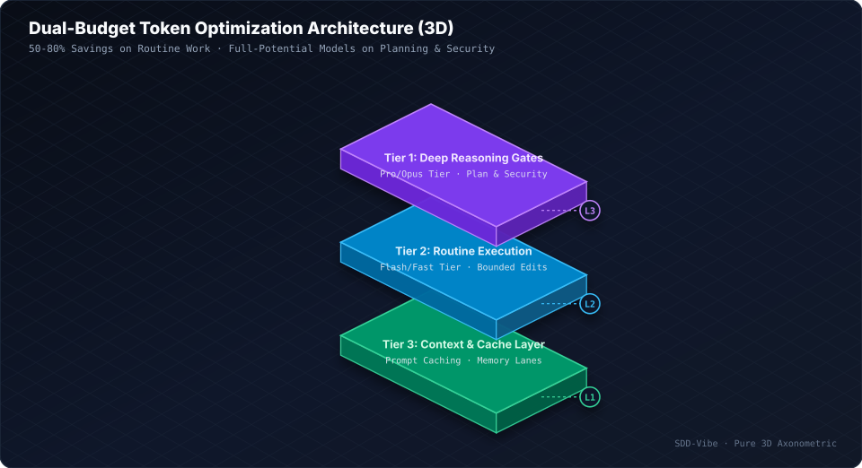
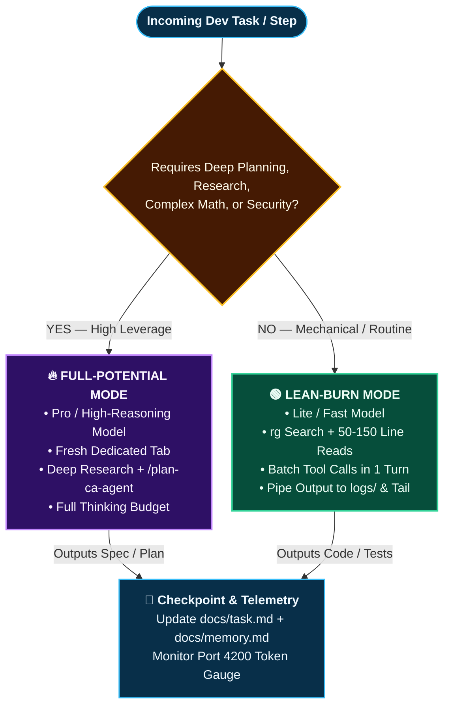

# SDD-Vibe Token Optimization & Full-Potential Model Strategy Guide
### How to Burn 50–80% Fewer Tokens on Routine Work While Unleashing Full Reasoning Power Where It Matters Most

<!-- SDD-VIBE-3D-DIAGRAM -->

[-blue?style=for-the-badge)](.)

**Engineering Lead:** Chandan Adhikary · **Standard:** Production-Grade Universal Release 2.0.0

---

## 1. Core Philosophy: Spend Smart, Not Cheap

Optimizing tokens does **not** mean starving the AI agent on hard problems. If you under-fund planning, research, or complex architecture, the agent makes shallow assumptions, writes buggy code, and you end up burning **3× more tokens** fixing rework.

Instead, **SDD-Vibe** uses a **Dual-Budget Token Strategy**:

| Budget Mode | When to Use | Model Tier | Goal |
| :--- | :--- | :--- | :--- |
| **🟢 Lean-Burn Mode (Save 50–80%)** | File discovery, boilerplate, UI CSS tweaks, log tailing, formatting, simple unit test scaffolding, routine docs sync | **Lite / Fast Models** + Batched Reads + Line Ranges | Zero wasted context; fast execution; preserve quota |
| **🔥 Full-Potential Mode (Invest Best Tokens)** | Deep research, `/plan-ca-agent` architecture (HLD/LLD), complex computations/algorithms, DB/RLS schema design, security threat modeling, hard debugging, `/verify-ca-agent` | **Pro / High-Reasoning Models** + Deep Thinking + Dedicated Clean Tab | Maximum accuracy, zero architectural flaws, zero rework |

---

## 2. Where to Use Full Potential (Never Skimp on Tokens Here!)

Allocate your **best models (Pro / High-Reasoning)**, **clean context windows**, and **full thinking tokens** to these high-leverage activities:

1. **Pre-Codebase Research & Requirement Grilling (Phase 1 / Step 1):**
   - Running `/plan-ca-agent` with `requirements-analysis` and `grill-me` to uncover hidden edge cases, compliance rules (HIPAA, FERPA, PCI), and domain invariants *before* writing code.
2. **System Architecture & Complex Data Modeling (Phase 1 / Step 2):**
   - Designing HLD/LLD (`docs/system-architecture.md`), PostgreSQL Row-Level Security (RLS), concurrency/locking, state machines, and API contracts (`docs/apis.md`).
3. **Complex Computations, Algorithms & ML/Data Pipelines:**
   - Financial ledger math, scheduling/routing algorithms, distributed race conditions, ML evaluation (`ml-evaluation`), and performance bottleneck profiling (`performance-profiler`).
4. **Security Threat Modeling & Audit Triage (Phase 4 / Step 6):**
   - Running `/security-audit-ca-agent` (`security-auditor`), reviewing RBAC/ABAC bypass vectors, and triaging `semgrep`/`trivy` findings.
5. **Hard Root-Cause Debugging (`/errorlogs-ca-agent`):**
   - Diagnosing intermittent failures, async race conditions, or memory leaks where a shallow guess would introduce a worse bug.
6. **Final Verification & Release Gates (`/verify-ca-agent`, `/release-check-ca-agent`):**
   - Cross-checking `AC-*` contracts against real `TEST-*` evidence before shipping.

> [!TIP]
> **Why Full Potential Here Saves Total Tokens:** Spending 20k–40k high-reasoning tokens on `/plan-ca-agent` once prevents 200k+ tokens of trial-and-error bug-fixing loops later.

---

## 3. The 5 Silent Token Killers (And How to Stop Them)

Every time you send a message in an AI chat, **the entire conversation history is re-sent** to the model. That means a sloppy habit multiplies cost on every single turn:

| # | Silent Token Killer | Why It Burns Quota | SDD-Vibe Fix | Estimated Savings |
|---|---|---|---|---|
| **1** | **Marathon Single-Tab Chats** | Turn 40 re-sends Turns 1–39 + every old file read on every reply | **1 Tab per Phase/Task** + checkpoint to `docs/memory.md` & reset | **50–70%** |
| **2** | **Reading Whole Files** | Reading a 1,200-line file when only 40 lines matter | Search with `rg -n` first; read **50–150 line slices** (`StartLine`–`EndLine`) | **60–85%** |
| **3** | **Loading All Skills & MCPs** | Dumping 18 skills + 10 MCP schemas into every prompt | **Progressive Disclosure:** load `SKILL.md` + 1–2 refs max; **1–3 external skills/step** | **30–50%** |
| **4** | **Pasting Raw Terminal / Test Logs** | Pasting 500 lines of passing tests or stack traces into chat | Redirect to `logs/test.log` or `logs/error.log`; read only **last 30–50 lines** or `ERROR` lines | **70–90%** |
| **5** | **1 Tool Call Per Turn** | Doing 6 sequential turns instead of 1 batched turn re-sends context 6× | **Batch** independent searches, file reads, and edits in **one parallel turn** | **40–65%** |

---

## 4. The 7-Pillar SDD-Vibe Token Optimization Playbook

### Pillar 1: Smart Model Tiering Matrix
Match the model to the cognitive difficulty of each SDD-Vibe command:

| SDD-Vibe Command / Task | Recommended Model Tier | Why |
| :--- | :--- | :--- |
| `/plan-ca-agent` (Architecture, Research, Grilling) | **🔥 Pro / High-Reasoning** | Needs deep synthesis, edge-case discovery, and zero-flaw HLD/LLD |
| `/tdd-ca-agent` (Complex Business Logic, Auth, RLS, Math) | **🔥 Pro / High-Reasoning** | Needs strict invariant reasoning and clean architecture |
| `/security-audit-ca-agent` & `/errorlogs-ca-agent` (Hard RCA) | **🔥 Pro / High-Reasoning** | Needs threat modeling and multi-file root-cause tracing |
| `/implement-ca-agent` (UI Shell, Components, CSS Tokens) | **⚡ Standard / Balanced** | Fast, high-craft UI generation without over-thinking |
| `/testing-ca-agent` (Running Suites & Checking Output) | **🟢 Lite / Fast** | Mechanical command execution and pass/fail parsing |
| `/task-ca-agent`, `/spec-check-ca-agent`, `/gitlogs-ca-agent`, Doc Sync | **🟢 Lite / Fast** | Structured template updates and deterministic checks |
| File Search, Log Tailing (`logs/*.log`), Formatting | **🟢 Lite / Fast** | Purely mechanical; zero reason to burn Pro quota |

---

### Pillar 2: Progressive Disclosure & Scoped Memory Lanes
- **Skills (`SKILL.md`):** Only load the single `SKILL.md` and the 1–2 reference files needed for your current step (per [`06-kanban-gsheet-and-token-ops.md`](SDD-Vibe-Framework/.agents/skills/agentic-team-ecosystem/references/06-kanban-gsheet-and-token-ops.md)). Never load all 14 team reference files at once.
- **Related-Agent Memory Lanes (`docs/memory.md`):** Instead of re-explaining the whole project in every new chat, agents read/write only their **Role Lane** (e.g., *Lane 2: UI/UX*, *Lane 3: Implementation & TDD*, *Lane 4: Security & Error Triage*) in 5–10 bullet lines.
- **External GitHub Tools for Token Savings:**
  - `serena` *(Tier 2)*: Semantic symbol-level code lookup & editing (avoids reading entire files).
  - `claude-mem` *(Tier 3)*: Cross-session compressed memory paired with `docs/memory.md`.

---

### Pillar 3: Multi-Tab Context Isolation & `/compact` Checkpointing
Keep separate IDE chat tabs so each context window stays small and laser-focused:
- **Tab 1 — Strategy & Blueprint (Full-Potential Model):** `/team-ecosystem-ca-agent` + `/plan-ca-agent` + `/task-ca-agent`.
- **Tab 2 — Frontend Sensory Demo (Standard Model):** `/implement-ca-agent` (UI) + `/run-ca-agent` (`:3000`).
- **Tab 3 — Spec Lock & TDD Backend (Pro for Logic / Lite for Test Runs):** `/spec-check-ca-agent` + `/testing-ca-agent` + `/tdd-ca-agent`.
- **Tab 4 — Audit, Release & Ops:** `/review-ca-agent` + `/security-audit-ca-agent` + `/release-check-ca-agent` + `/dashboard-ca-agent`.

**When a tab gets heavy (>15–20 turns or >50% context gauge):**
1. Ask the agent to checkpoint **Next Authorized Action + Modified Files + Open Questions** into `docs/memory.md` and `docs/task.md`.
2. Either run `/compact` or open a **fresh chat tab** and point it only to `docs/memory.md` + the active `FEAT-###` spec.

---

### Pillar 4: Economical Code Reading & Batched Turns
1. **Locate before reading:** Use `rg -n "symbolName"` or file search first.
2. **Slice reads:** Read only lines `StartLine`–`EndLine` (50–150 lines) around the target function.
3. **Batch parallel operations:** Request all related file reads, searches, or edits in a **single prompt** so the agent executes them in parallel instead of burning 5–10 extra round-trips.

---

### Pillar 5: Spec-First & Test-First Zero-Rework Loop
Vibe-coding backend logic without a spec causes hallucinated schemas and repeated rewrites.
- **Phase 2 (`PROTOTYPE` UI):** Iterate cheaply on mock data at `:3000` until layout is approved.
- **Phase 3 (`APPROVED` Spec + TDD):** Lock `AC-FEAT###-##` once, confirm `RED` tests, then write the **minimal** code to turn tests `GREEN`. Zero guesswork = minimum tokens.

---

### Pillar 6: Log & Terminal Output Filtering (`logs/`)
Never paste full build or test output into the chat:
- Pipe test runs to `logs/test.log`, dev server logs to `logs/server.log`, and errors to `logs/error.log`.
- Inspect only the summary or last 30–50 lines (e.g., `Get-Content logs/test.log -Tail 40` or `rg -n "FAIL|ERROR" logs/test.log`).

---

### Pillar 7: Live Monitoring via Project-Manager-Dashboard (`127.0.0.1:4200`)
Launch `/dashboard-ca-agent` (`http://127.0.0.1:4200`) and watch the **AI Model Profiles & Token Telemetry** module:
- **Context Capacity Gauge:** Trigger `/compact` or a fresh tab before hitting the yellow/red zone.
- **Prompt Cache Hit Rate:** Fresh, focused tabs with stable prefixes achieve high cache hits (dramatically cheaper input tokens).
- **5-Hour / Hourly / Daily Rate Windows:** Shift routine tasks to **Lite/Fast** models when approaching window limits, reserving **Pro** quota for `/plan-ca-agent`, complex math, and `/security-audit-ca-agent`.

---

## 5. High-Burn vs. Low-Burn Prompt Examples

### Example 1: Fixing a Bug
- ❌ **High-Burn Bad Prompt (~45k tokens wasted):**
  > *"Here is my whole 600-line error log [pastes 600 lines]. Check the whole `src/` folder and fix why patient login is failing."*
- ✅ **Low-Burn High-Precision Prompt (~4k tokens, faster & more accurate):**
  > *"Run `/errorlogs-ca-agent` on the last 40 lines of `logs/error.log` for `AC-FEAT001-02`. Search `src/auth/` with `rg` for `verifyPassword`, read only that function, write a failing regression test first, and fix it."*

### Example 2: Planning a Complex Feature (Full-Potential Mode)
- ❌ **Under-Funded Bad Prompt (causes 3× rework later):**
  > *"Quickly build hospital billing and insurance claims."*
- ✅ **Full-Potential Smart Prompt (1× planning, 0× rework):**
  > *"Switch to Pro/High-Reasoning model in a clean tab. Run `/plan-ca-agent` for `FEAT-005` (Hospital Billing & Insurance Claims). Use `requirements-analysis` and `grill-me` to ask me clarifying questions on tax, partial payments, and RBAC, then output HLD/LLD + DB schema in `docs/system-architecture.md` and `AC-FEAT005-*` contracts before writing any code."*

---

## 6. Daily Token-Hygiene Checklist

- [ ] **Right Model Selected:** Pro/High-Reasoning for `/plan-ca-agent`, complex algorithms, DB/RLS, & security; Lite/Fast for file search, log tailing, & routine tests.
- [ ] **1 Tab = 1 Phase/Task:** Separate tabs for Planning, UI Demo, TDD Backend, and Audit.
- [ ] **Targeted Reads Only:** `rg -n` first, then 50–150 line slices—never full-file dumps.
- [ ] **External Skills Bounded:** Max 1–3 external skills per step from `07-curated-external-skills-registry.md`.
- [ ] **Logs Redirected:** Verbose output written to `logs/*.log`, only tail/errors read into context.
- [ ] **Checkpoint Before Reset:** End sessions by updating `docs/memory.md` (Memory Lanes) and `docs/task.md`, then `/compact` or start a fresh tab.